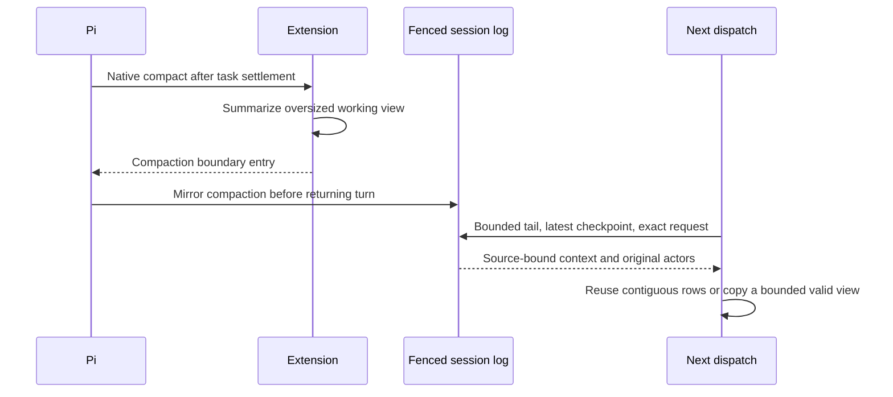

# Follow-ups keep a continuation checkpoint

Adopt this change for session follow-ups. The reader is an engineer new to this area. Source delivery and local checks precede a separate deployment decision.

## Decision

A long run must leave useful context for its next request. After a successful task turn settles, the harness requests a native compaction when its working view exceeds the follow-up budget. The extension uses pi's shared summary generator under that command's abort signal. The summary becomes an ordinary compaction row before the harness returns the turn. The next run reads the latest checkpoint independently of its transcript tail and recovers the previous run's exact request when the tail has no usable opening. This adds one summary operation for a qualifying run and bounded continuation reads. It adds no store, task writer or execution authority.

## Today at `4361c1615b1975e3bef42c4e746b9a479f4848e1`

| Fact | Source |
| --- | --- |
| A follow-up reads at most 240,000 bytes, estimated as 60,000 tokens | `src/core/dispatch/seed.ts` |
| A tail without a user message containing text contributes no prior transcript turns | `src/core/dispatch/seed.ts` |
| A summary travels only if its compaction row fits that tail | `src/core/runLedger/inMemory.ts`, `deploy/cloudflare-memory/worker.ts`, `src/core/runLedgerWorker.ts` |
| Notes and cumulative source obligations already travel outside transcript rows | `src/core/dispatch/seed.ts`, `src/core/dispatch/provision.ts` |
| Pi's mirror persists compaction entries through the current owner's fenced step write | `src/core/harness/pi/mirror.ts`, `src/core/runLedger/writeThrough.ts` |
| The harness waits for `agent_settled` before ending pi | `src/core/harness/pi/harness.ts` |

## Shape

This is a snapshot plus log tail. The snapshot remains a pi compaction row. The tail response also returns the newest compaction's exact index and entry, even when that row is outside the selected tail. The session log, source closure, notes and recall retain their existing ownership.

## A long review followed by another request

A reviewer finishes after a long series of tool reads. The harness observes `agent_settled` and checks the UTF-8 text and structure of its working view against 240,000 bytes. Above that limit, with useful time remaining and no stop in progress, it sends one native `compact` command. It does not send another task prompt or change the live model window.

The extension recognizes the continuation command in `session_before_compact`. It summarizes the complete current working view through the pinned SDK's shared generator and selected model registry. Pi's summary serializer omits system messages, so prior system-context snapshots enter this summary call as explicitly quoted evidence. This preserves access to prior summaries and notes without granting authority. The summary call uses the registry's provider-neutral `streamSimple` path, which maps the selected effort to each provider's request fields. The selected model and effort remain unchanged. The native compaction signal reaches the summary call. Empty, oversized, truncated or aborted summaries cannot produce a checkpoint.

The extension returns a self-retaining compaction with `firstKeptEntryId: null` and a typed continuation marker. Pi normalizes the retained pointer to the entry's own ID, writes it and emits `compaction_end`. The bridge records its continuation scope, and the mirror awaits the normal fenced step write before the command response ends the wait. The original authored answer remains the reply. The same mechanism covers post-loop task turns. A failed summary leaves the answer intact and records that context may require recall. The extension returns an explicit cancellation on failure because a thrown hook error makes pi try its default summarizer. Pi's native error-notification API retains a structured `continuation_checkpoint_refused` receipt in the run log. It contains the run ID and a closed reason for cancellation, truncation, empty output, the byte bound or provider failure. It contains no summary text or raw exception. Pi's RPC stdout guard redirects ordinary console writes, so the extension uses the public notification API and the bridge retains error notifications.

The next run reads the newest checkpoint from the same session, independently of the tail's byte cut. If ordinary row reuse yields no opening, exceeds the combined history budget, or excludes the previous request, dispatch reads one exact row: `session.request` of the newest finished run of that agent on the selected session, including a failed or interrupted run when it has a session record. This preserves the previous request, not every earlier user turn. Notes and the summary carry other useful context; recall reaches original retained evidence.

Dispatch reserves bytes for the request, notes and summary, then selects a bounded recent suffix after that request. Rows covered by a complete continuation checkpoint stay in the retained log instead of being copied again. It drops results whose calls are outside that suffix and answers a trailing call with an error result stating that its effects are unknown and must be checked before repetition. When the original request and suffix are not contiguous, dispatch copies the view as new rows with original actors. It never claims false row reuse. A source read failure, incomplete request or protected context over the budget refuses continuation.

## Difficulty and boundaries

**Settlement and cancellation are the main risk.** A checkpoint runs only after a successful settled task turn. The harness continues to read the existing transport while the compaction command runs. It does not drain ordinary follow-ups into that command. A hard stop still stops the run. A soft stop or the existing loop deadline aborts the summary. The harness waits for the original compaction response or a correlated abort response, which pi sends only after it becomes idle. This wait uses the existing run or post-turn deadline. If native idle remains unconfirmed at that bound, the authored answer is retained and further prompts on that session are refused. A reset that leaves compaction delivery unknown never replays the summary command; recovery continues on the original process. An unrecoverable checkpoint transport also retains the answer and prevents further prompts. Replacement evidence remains visible to the shared session ending even after task settlement. Cleanup never sends an old PID or root to a known replacement. A completed checkpoint releases its bot-side relay registration because no relaunch follows its answer; actual relaunches retain their existing handoff. When recovery cannot confirm the original producer's placement, the session ending retains custody through the existing unconfirmed-ending error. A missing FIFO inside the original container disables the checkpoint and further prompts without discarding the completed answer. The compaction operation owns its abort signal, and pi checks that signal before persisting the summary. A process or storage failure can prevent an acknowledged checkpoint. It cannot establish a successful one.

**A summary is evidence, not authority.** The exact request and its actor come from retained rows. Refused requests use the existing stand-in. Copies retain the cumulative source obligations and pass the same admission checks. Summary text cannot replace identity, grant source access or prove that an unresolved operation completed. This preserves [record 0103](0103-context-is-a-bounded-view-of-source-bound-work.md).

**A missing or old summary leaves a named gap.** Legacy or interrupted runs can have no checkpoint. Their fallback retains the request, notes and recent complete exchanges. When rows between the checkpoint and selected tail are absent, the prompt names the exact omitted range and directs recall before relying on those details or repeating unresolved work. It does not claim that every historical correction survived.

Both reused and copied history, summary and notes share the existing 240,000-byte budget. Top-level and tool-result media keep their existing attachment limits; base64 payloads do not consume the text-history budget. The current request and existing later channel lines keep their existing admission rules. Reads select one exact request, the bounded tail, one latest compaction and the bounded notes. Dispatch never reads the whole transcript to generate a summary. No schema migration or additional memory service is required.

## Alternatives

Increasing the tail budget moves the failure boundary. Lowering the live model window to the follow-up budget forces compaction throughout a task that could use its larger window. Calling pi's manual compact command inside the before-settlement hook waits for the same run to become idle, and that hook exposes no active task signal. Calling the native command after task settlement gives the summary its own cancellation signal. The shared generator gives the checkpoint complete working-view coverage. A second summarizer service duplicates provider and summary machinery. Voluntary notes alone do not guarantee a checkpoint.

## Validation and limits

The session-log and harness-pi specs bind the regression tests. Local fixtures must prove request, notes, summary, actor and complete-exchange recovery; checkpoint reads outside the tail; refusal on unavailable or oversized protected context; summary generation without another task turn; and preservation of the authored answer through a mirrored checkpoint. Provider failure and cancellation must not yield a partial checkpoint. Scoped type, formatting, spec and hygiene checks assess the changed source. Native review and CI assess the final PR head. Local synthetic summaries do not prove semantic recall quality, deployment or live provider acceptance.
