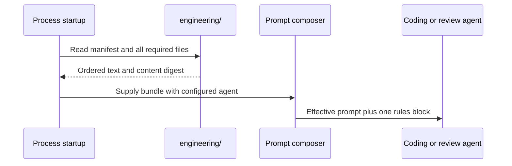

# Engineering rules compose before work

Use the existing common prompt composition point for a portable engineering policy, because optional skill loads cannot cover an agent's first action. Export the same policy into local clients' startup instructions. This record is for an engineer new to the loading paths. Implementation does not authorize deployment.

## Decision

Five short Markdown files under `engineering/` define general coding, design, errors, observability and verification. An ordered `manifest.json` selects them. The process reads and validates the bundle at startup. The prompt composer adds its text once to every coding and review request, independently of skill selection and prompt replacement. This adds one startup file read per rule and one prompt block limited to 8,000 UTF-8 bytes; skills remain optional methods. Local clients receive the same bytes through a commit-pinned import in the existing Worklog projection tool.

## Today at `e7bda4291c54f1b5f95eecb5e85af2e0de5595d5`

| Fact | Source |
| --- | --- |
| Every successful skill load adds prose rules, but only after the agent calls the tool | `src/tools/skills.ts` |
| The built-in coding prompts have three workspace variants with shared workflow constants | `src/agents/registry.ts` |
| Literal configured instructions replace all three prompt variants | `src/config/agents.ts` |
| One composer selects the effective prompt and adds the skill guidance | `src/core/reviewRound.ts`, `src/core/dispatch/provision.ts` |
| Third-party skill bodies are pinned and checked against their upstream source | `src/skills/manifest.ts`, `skills/manifest.yaml` |

## Shape and hard case

This uses composition: the process supplies an immutable bundle as data, and the composer adds it beside the agent instructions. Files use plain Markdown so another client needs only a distribution adapter. There is no skill inheritance graph or runtime network fetch.

A coding request can replace the built-in instructions and use a resident workspace. The composer selects that effective prompt, then adds the supplied bundle. The first model call contains the rules even when the agent never calls `use_skill`. Loading several skills does not add the bundle again. `run_meta` names its file list and digest; the build stamp identifies the deployed source revision. This proves delivery, not model compliance.

The hardest part is complete prompt coverage. The next risk is local startup loading and drift between source and exports. Distribution requires more adapter work than prompt composition.

## Coverage and failures

The service and CLI composition roots both load the required bundle. Missing or malformed manifests, duplicate names, unsafe filenames and empty or missing rule files fail startup with their original cause. Unit callers can supply a synthetic bundle without reading the host. General and research prompts receive no engineering block. A configured coding or review prompt still receives it. A resumed run uses its saved system prompt verbatim and keeps its original policy provenance. It must not claim delivery of the current process bundle. An already running harness keeps the instructions it received.

Repository instructions supply concrete error types, logging APIs and architectural seams. The portable rules require explicit failure handling and idiomatic design. They preserve task scope and permission limits. The coding or review agent must state a conflict before dependent work. It applies explicit user decisions within their scope and asks the owner when those decisions and repository evidence cannot resolve the conflict; authorization stays enforced in code.

## Local distribution

Worklog's existing tool imports `engineering/manifest.json` and each selected file from a full Git commit. It records the repository URL, revision, ordered file contents and digest in one local JSON snapshot. The tool atomically replaces that single file after all source reads and validation pass, so an interrupted replacement leaves a complete old or new snapshot. Normal `apply` and `check` validate the snapshot digest; they never follow a moving branch or require the source checkout to remain on disk. The projection tool appends the full compact bundle to both global instruction files before client overlays. Presence is automatic when a snapshot is imported, independent of include directives. The unchanged PR-loop detail moves behind a required-read link for PR work; this frees space under the existing 15 KB limit. Coding skills refer to the same imported snapshot for standalone use. Both generated files must contain every rule, so loading does not depend on a voluntary file read. A fresh chat remains the check of actual client startup adoption; existing chats can retain old instructions.

## Alternatives

- Repository instruction files alone do not apply service defaults to every target repository. Local global files do not supply instructions to Switchboard's hosted runs. Use client adapters over one source.
- Repeating policy in each skill permits drift and leaves work without a skill uncovered. Use the common prompt composition point instead.
- Adding the bundle to every `use_skill` result leaves the first edit uncovered and repeats the text across loads.
- A new policy service or package registry adds a deployment and runtime dependency for five local files. Start with a flat manifest and checked imports.
- Full SOLID or refactoring manuals consume context without defining local decisions. Keep baseline rules short; load detailed methods only when relevant.

## Acceptance

Focused tests must prove ordered loading and failure handling, exactly one block across the three coding variants and a literal replacement, review coverage, and unchanged non-coding prompts. A dispatcher test must tie delivered policy to `run_meta`. Deployment input checks must treat engineering Markdown as shipped bot input. The local CLI must prove pinned import, drift refusal, idempotent projection, client isolation and refusal to overwrite unmanaged files. Existing failure-path checks and review assess compliance; prompt delivery alone cannot prove it.

The living contracts are [skills](../reference/specs/skills.md) and [release and deploy](../reference/specs/release-and-deploy.md). Source, CI, review, merge, deployment and live acceptance remain separate stages.

## Basis

The design rules apply [Beck's Simple Design](https://martinfowler.com/bliki/BeckDesignRules.html), [Tidy First](https://newsletter.kentbeck.com/p/structure-and-behavior), [Fowler's refactoring method](https://martinfowler.com/books/refactoring.html) and [YAGNI](https://martinfowler.com/bliki/Yagni.html). These sources guide small, reversible changes and clear responsibilities; they do not require a new abstraction for every principle.
