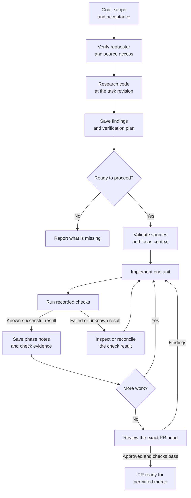
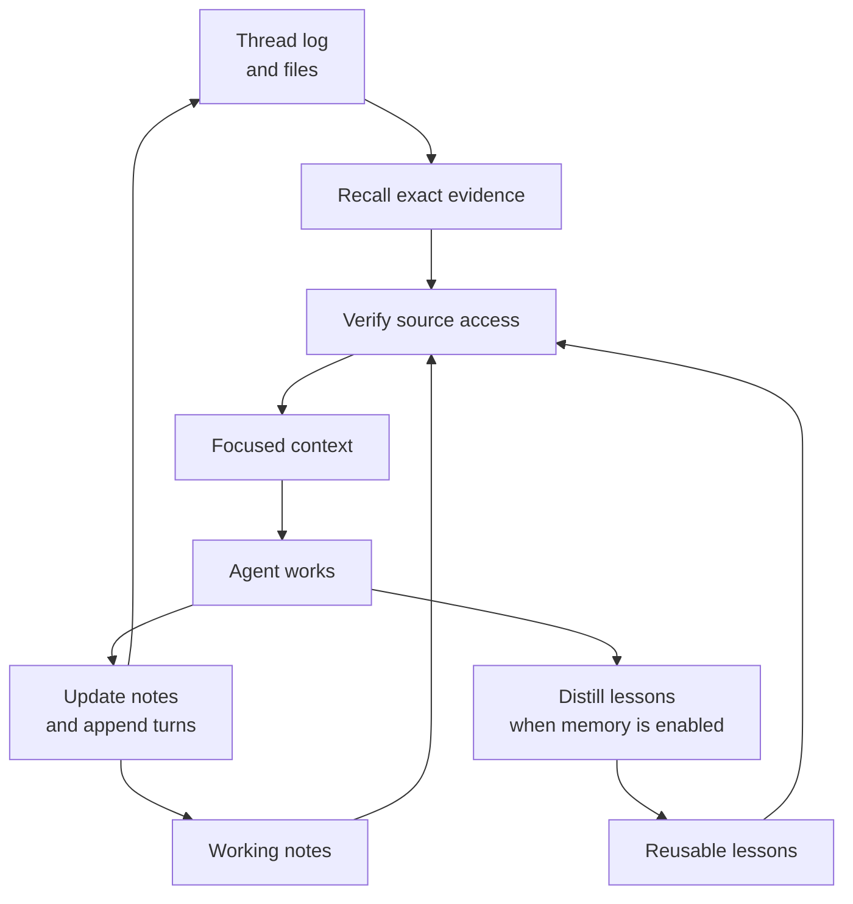
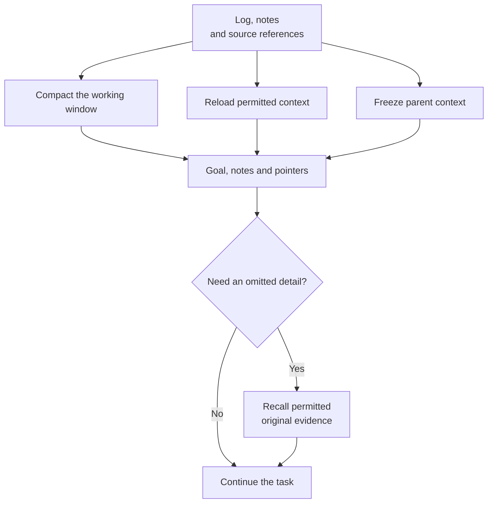

# How agents keep context

Switchboard keeps a small working account of a task while preserving access to its original evidence. Research gives the worker a plan grounded in sources. Notes keep the goal, decisions and next step in view. Recall retrieves details when the worker needs them. Memory carries reusable lessons between tasks.

## The work flow

Ship runs research as part of the admitted work plan. A small task can use a short source check. A complex task needs enough investigation to explain where the change belongs, which assumptions it relies on and how to test it. Research names unresolved decisions instead of inventing an answer.

The admitted request and authenticated follow-up instructions define the task within its authorized scope. A research brief helps carry it out; it cannot grant permission, change the requester or replace the agreed goal. Coding starts on the inspected revision. A continuation can use the unit's recorded branch progress. In both cases, the research sources must remain available and permitted.

Implementation, review fixes and rebases keep the same original research source. Recovery checks that source again before work continues. A later round cannot clear these obligations.

A bounded repair of an existing unit uses the same source checks. A conflict repair keeps the original requester, research and current target within its admitted repair budget. A clean rebase followed by review does not start another research phase.

Verification and review serve different purposes. A recorded check proves which command completed and what it returned. Review checks the code against the task and specifications. Merge, release, deployment and live acceptance have their own gates.

## Three kinds of remembered information

| Information | Purpose | How an agent uses it |
|---|---|---|
| Working notes | Keep this task's goal, decisions, rejected approaches, progress, evidence and next step visible. | Read at the start of a run and during context recovery; update at useful phase boundaries. |
| Thread log and files | Preserve the original conversation, tool results and artifacts within retention. | Use recall to search or read the exact source, including a parent's frozen evidence. |
| Reusable memory | Carry durable lessons across tasks, such as a cause and remedy or a repository convention. | Retrieve a bounded set of permitted records; verify a lesson before acting on it. |

Keeping information does not require loading all of it into every model call. A worker receives its task, relevant source context, working notes and recall references. Original tool output stays available for a precise read instead of filling the prompt with an entire investigation.

## Phase notes

A useful checkpoint answers seven questions:

- What phase is this?
- What is the current goal?
- Which decisions matter, and why?
- Which approaches were rejected?
- What work is complete?
- What remains unproven?
- What is the next step?

A checkpoint saved with a recorded verification also carries the check's identity and observed checkout. It separates the agent's account of completed work from the actual command result. Exit zero alone does not establish test coverage or prove every reported item.

A failed, interrupted, unknown or replayed check does not replace phase notes. If saving notes is unconfirmed, the agent reads the stored notes and reconciles that uncertainty. It does not repeat the command merely to obtain another notes write.

## Compaction, continuation and children

Compaction changes the working window. It does not make an earlier claim true, remove a source restriction or confirm an uncertain tool effect. A continuation preserves the admitted task and uses the stored log to reconcile commands and messages.

A child's snapshot fixes which parent evidence it may recall. Later parent messages do not silently enter that snapshot. Parent notes are read-only to the child; the child keeps its own notes. Large context is bounded, and an omitted range or unavailable source is stated explicitly.

Retention is finite. A source that has expired, been revoked or lost its proof is unavailable. The agent reports that limit rather than guessing or treating a summary as renewed access.

## Checking that context helps

The context evaluation runs labelled local tasks through the notes, recall and context-selection paths. It checks corrected goals, exact failure evidence, retained rejected approaches and frozen child sources. Grading labels stay outside model input.

The report records task outcomes, missing evidence, repeated failed commands, preserved notes, reported tokens and wall time. Missing usage and prices remain unknown. A comparison is valid only when task sources, labels, model, effort, environment and execution limits match.

Local synthetic trials qualify the measured task and its context path. They do not establish production restart behavior or general model quality.

See [Context lifecycle](../reference/context-lifecycle.md) for the storage and execution contracts, and [Durable context](durable-context.md) for source access and retention.
