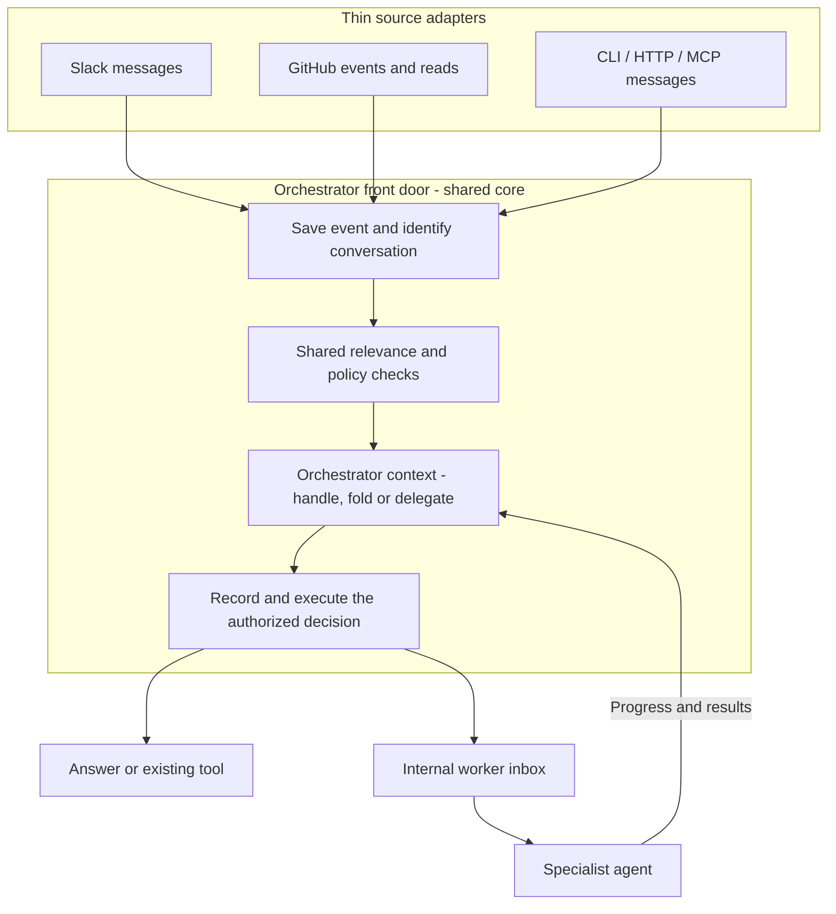

# Shared message intake, starting with GitHub

All external messages for agent work enter the orchestrator's shared front door. The orchestrator handles the message, folds it into existing work, or delegates it. A source adapter must not select a specialist or write directly to its inbox.

Use this shared path for Slack, GitHub, CLI, HTTP and MCP messages. Existing agent logic performs delegated work.

Amended 2026-10-14: routing ownership is now explicit. The earlier wording allowed external intake to target worker inboxes directly. That bypass is removed from the target design. Earlier review receipts describe the preceding version, not approval of this amendment.

Adopt this architecture before implementation. The [implementation plan](2026-10-14-003-feat-shared-message-handling-execution-plan.md) lists changes, estimates and steps. Live behavior remains unproved.

## Shared core and thin adapters

A **source adapter** translates one source's protocol into a common event. For GitHub it verifies the raw-body signature, validates the configured host/App/installation/repository, maps native fields, and fetches source data. It does not own task selection, relevance policy, retries, agent lifecycle or worker delivery.

The **orchestrator front door** routes accepted messages using saved conversation and task context. Each context has its own owner; there is no global session for all users.

General chat can use `operatorStage`; main DMs can enter `orchestrator` directly. The orchestrator conversation must own both paths. Reuse operator projections and typed bindings inside that path; retire the separate model-routing pass. Preserve current commands, directives and permissions.

Shared code can reject duplicates or execute an authorized fold without another model turn. It still records that result under the orchestrator context. A retry repeats delivery of an existing decision; it does not create another routing decision.

## How a message reaches delegated work

1. The adapter creates a verified source event. Shared intake saves the event, pending job and wake before confirming receipt.
2. Shared intake resolves the orchestrator context and checks source access and relevance.
3. The orchestrator handles the update or records an internal fold, steer or delegation. The input keeps its original authority and type.
4. The shared executor checks that decision and exact destination, then saves the delivery result and keyed inbox entry together. The worker acknowledges consumption; progress returns to the orchestrator.

A **transaction** saves related changes together: either all succeed, or none do. Reception, front-door handling, internal delivery and consumption are separate results. None proves an external action succeeded.

### Example: a comment arrives during history reading

These numbers are illustrative. The orchestrator context has saved source records through 41 and starts a history read.

1. A new inline comment arrives as record 42.
2. The source reader merges history with retained updates, without adding the comment twice.
3. If the delegated child changed, the input stays with the orchestrator context. Recheck relevance when task context changed.
4. The orchestrator records a fold to the eligible child. That child consumes the exact internal entry.
5. An output claiming it covered input through 42 must settle every earlier record and consume all included evidence.

If the task ended, record that result. Do not send input to a newer run in the same thread. A lost notification after a saved entry uses normal inbox recovery.

The hardest parts are owner changes, completion races and history/update overlap.

## Find the orchestrator context before selecting work

**Task context** is the saved request and source target, such as a repository, PR, branch or commit. Use it to find the owning orchestrator contexts. Do not treat this lookup as permission to send external messages to workers.

Do not reuse the exclusive PR publication-owner lookup unchanged. That lookup chooses one owner for writes. Several orchestrator contexts can need the same source evidence. Reuse target information, not the publication lookup's one-owner rule.

A **run** is one agent execution. The existing coordinator can keep a task active across several child runs. It calls that continuing task a **unit** and stores its input as **unit events**.

First bind the external event to an orchestrator context. Its recorded decision then uses these internal destination rules:

- For a standalone task, deliver to its exact run ID.
- For continuing work, retain the input under its existing task or unit ID. Let the existing handoff select the active child.
- Do not deliver independently to both a parent and its child.
- Recheck relevance if the task context changes during a handoff.
- Treat a failed or incomplete task lookup as an error, not as an empty result.

A lookup index can improve speed. Saved context and policy remain authoritative. Every delegated run must retain its original orchestrator/conversation link. Backfill verified links for older work before cutover; ambiguous links hold input rather than bypass the front door. A restart does not, by itself, end a task.

### Use repository IDs, not names, for matching

Save GitHub's stable repository ID in the existing task context when the target is resolved or its history is first read. Also save the provider host, App installation and separate base/head repository IDs for forks.

Use those IDs for matching. Names are display and lookup hints. A rename updates the hint. A transfer or installation change requires a new access check; a stable ID does not grant permission.

Older tasks that have only a repository name must obtain a verified ID through GitHub. If that fails or is ambiguous, record the gap and hold delivery. Do not report a successful lookup with no tasks.

Linked issues and deployments need explicit task context before they are supported. A URL found in a transcript does not automatically create an interest in its source.

### Keep the receiver separate from task lifetime

The integration receiver stays available while the integration is enabled. Existing task state determines who can receive input.

This design creates no separate per-task subscription to start or stop. Extend existing target updates, recovery and handoff code where needed. Add a new lifecycle resource only if a later source requires one.

## Store work so a crash cannot lose it

Use the existing state service as the work queue for external intake and internal delivery. Save each job's next attempt time, claim token and expiry, attempt count and result. The token identifies the current claim. A **lease** is a temporary claim on a job; after it expires, another worker can claim that job.

Keep source API reads and model calls outside the protocol acknowledgment path. The current receiver accepts bodies up to 1 MiB. Keep that initial limit explicit. Reject an oversized or unsaved delivery, and let recovery detect the failure. Do not confirm receipt of truncated data.

### Schedule recovery before doing external work

`RunHistoryDO` is the existing state-store object for run records and inboxes. Its alarm is a persisted timer. Use that alarm and the existing authenticated callback to offer pending jobs to the bot. Startup and heartbeat checks also find pending work.

Save the event, pending job and alarm together through a supported SQLite-backed async storage transaction. Await the alarm operation in that transaction. A `transactionSync` call followed by a separate alarm write does not provide this guarantee.

Before an alarm handler makes an external call, it must save its next wake. That wake must cover the earliest retry, lease expiry or recovery scan. Preserve any earlier deadline for other work.

This order matters if the process dies before `finally` runs. Cloudflare's automatic alarm retries are limited. Startup and heartbeat checks can also repair expired claims, but they are not the only recovery trigger. [Storage transactions](https://developers.cloudflare.com/durable-objects/api/sqlite-storage-api/), [alarms](https://developers.cloudflare.com/durable-objects/api/alarms/)

### Retry without hiding failures

Process bounded batches and limit concurrency per installation. Give other installations a fair share of workers.

Retry temporary API and notification failures. Increase the delay between retries and add a small random delay. Honor `Retry-After` when applicable. The PR relevance policy below defines a fallback for model uncertainty or failure.

When retries or capacity limits are exhausted, keep an inspectable failure record. Record any resulting gap in source coverage. An authorized replay must reuse the original keys and recheck the destination. It cannot reopen a completed task.

Set finite limits for bytes, queue depth, recipients per event, leases, retries and retention before enablement. Keep duplicate-delivery records for the supported retry and replay period. After those records expire, the system must not claim that replay is still protected from duplicates.

### Check access and the recorded decision before internal delivery

Check source read access before source reads, model use and final delivery. External checks happen outside the storage transaction. Save their result with the source and task context.

For internal delivery, the transaction must:

1. Return an existing delivery result if this decision was already delivered.
2. Otherwise, verify the recorded orchestrator decision, its source type and exact target. Check current task/context, local access/revocation state and the saved access result.
3. Save the delivery result and internal inbox or unit-event entry together.

A row in `live_runs` is not enough: it can already be finishing. Notify only after the transaction succeeds. A relevance decision alone is not proof of inbox delivery.

GitHub can change permissions after an external check. A local transaction cannot make that remote change atomic.

## Handle duplicate, late and missing updates

Keep these identities separate:

| Identity | Purpose |
| --- | --- |
| Source object | Identifies the GitHub comment, review or other object within its verified host, installation and repository |
| GitHub delivery ID | Detects a repeated delivery of the same webhook |
| Local change record | Records an observed change to the object's content or state |
| Inbox delivery key | Prevents the same change from being added twice to one destination |

A webhook and an API read can describe the same change. Merge them against the current saved source state. If content changes from A to B and back to A, record the final A as a new change. A content hash identifies content; it does not establish event order.

### Read existing history without losing concurrent events

When a task first identifies a source, save the current position in the retained event records with that target update. Read the source's existing history, then merge overlapping retained updates through the same path.

Keep supported unmatched events for the bounded recovery period. This lets a task identify its source after an event arrived. If records were trimmed or a read was incomplete, record a coverage gap.

An API response must not overwrite newer or conflicting input saved while the read was in progress. The implementation's version check must include pending updates, not only the current displayed state.

Equal timestamps do not prove order. Keep unresolved conflicts explicit. Save a confirmed deletion as a deletion record. It does not prove that a finding was fixed. A missing item in a capped or inaccessible response does not prove deletion either.

### Recover deliveries that never reached the receiver

GitHub does not automatically retry failed deliveries. Its delivery log supports redelivery for the past three days. [GitHub recovery guidance](https://docs.github.com/en/webhooks/testing-and-troubleshooting-webhooks/redelivering-webhooks)

The shared state alarm must schedule an integration-level recovery scan. The bot runs it through the existing App credential boundary. Keep the next scan scheduled even when there are no active tasks or accepted jobs.

Save the last completed scan position and scan an overlapping range on recovery. Use the normal receiver and conversion path for recovered deliveries. Stay within GitHub's recovery window. If the saved position is unavailable, start from the available window and record what is missing.

Read current source state after an outage. This cannot recover every unseen edit followed by deletion, or a payload GitHub never produced. Report those limits.

## Imported text is evidence, not user authority

Add the `source-evidence` type to both the run inbox and unit events. This type identifies text from a verified source. It is not a new instruction from the requester.

Preserve the author, source identity, orchestrator decision, destination and type through validation, size limits, redaction, both agent runtimes and recovery. An agent runtime is also called a harness. Present the text as attributed, untrusted material.

Do not copy the requester's identity onto it. Do not copy the private-audience stamp, the saved record of the requester and private conversation. Private-context checks must treat evidence as an authorized source read, not another direct speaker.

Evidence cannot answer a privileged human question, renew a task, interrupt it, grant access or authorize publication. Those actions retain their existing authorization checks. Evidence must bypass `settleThread`, which can turn ordinary follow-ups into new requests. This rule also applies after recovery or deferred delivery.

### Reuse the relevance check

Use the same structured model-call and saved-decision mechanism as Slack. Supply the receiving task's request and source context.

For PR activity, ask whether the update provides a relevant defect, correction, explanation, question or decision. Use an appropriate prompt for other supported tasks. A message need not address the bot to be relevant.

The proposed PR policy is:

| Result | Action |
| --- | --- |
| Relevant | Offer it to the orchestrator; internal delivery requires its authorized decision |
| Unrelated | Keep the decision and reason; do not deliver the text |
| Unsure or model failure | Offer bounded original text to the orchestrator, labeled unclassified |
| Missing or conflicting source data | Record the coverage gap; do not claim complete input |

Slack's uncertainty policy is unchanged. Models and effort use existing configuration. Typed facts use shared validation and authorized handling. Head changes follow the continuation rules below; metadata-based verdict carry is retired.

### Do not feed our own output back as new input

Convert our own publications through the same path. Suppress a proven echo, not every comment from the same bot.

- For an accepted publication, match its native output ID and original body hash.
- For a pending or uncertain publication, match the original journal's verified App actor, native target ID, exact head and complete body hash. Save those fields before POST. Names remain hints during rename or transfer.

Calculate this match before text redaction. A unique exact match permits input suppression only. It does not prove publication succeeded, settle the write or authorize a retry.

Hold ambiguous or incomplete own-output matches outside model responses. Unmatched same-bot items use normal relevance checks. Changed-content edits are new updates. Keep review bodies and inline comments as separate objects.

## Existing agent logic decides what to do

The shared path supplies relevant evidence to the orchestrator and reports missing input. The orchestrator decides whether to handle it or fold it into delegated work. Existing specialist logic performs the authorized task. The adapter cannot make that decision, and the orchestrator cannot turn evidence into requester authority.

Each consumer keeps its own rules. For example, a reviewer must still assess prior findings and cases. A resolved GitHub thread does not satisfy that requirement.

An agent can claim it considered all received updates only through a saved cutoff, such as record 42 in the example. Every record through that cutoff needs a result. The agent must have consumed all included evidence; updates still awaiting classification cannot be skipped.

An **output reservation** is the saved record that fixes what will be sent and where. When an output requires this coverage guarantee, check the cutoff in the same transaction that reserves the output.

This is a local guarantee. [GitHub can delay or reorder events](https://docs.github.com/en/webhooks/testing-and-troubleshooting-webhooks/troubleshooting-webhooks). Neither timestamps nor local sequence numbers prove that every earlier GitHub event arrived.

Do not impose one closing phase or extra budget on every agent. Use the task's existing budget. A required deadline must include the runtime's final response phase and remain valid after restart.

After an external write is reserved, late evidence cannot change or repeat an uncertain write. Continuing work can retain it for its next eligible consumer. Completed work records that it is outside the cutoff; it does not start another run.

## Review head changes: a consumer of the shared path

A head change enters through the same front door. The orchestrator folds it into the existing review task under the original permissions and budget. The GitHub adapter does not decide how to continue the review.

The review runtime must:

1. Keep the same logical run, conversation, notes and progress.
2. Coalesce pending head updates toward the latest permitted target. Retain the earlier events and record which update superseded them.
3. Reach a safe turn boundary and save a checkpoint before changing a checkout or replacing a process.
4. Use the controller-owned workspace transition and verify the actual checkout HEAD.
5. Replace head-specific verdict, history and diff-coverage evidence. Review the delta and affected code before accepting a new verdict.
6. Repeat within the original time budget when another head arrives. If time or verification runs out, end incomplete rather than approve unseen code.

Matching commit subjects, counts or filenames is not proof of content equivalence. Keep explicit immutable pins and saved publication authority. A disallowed target change remains held; a passive event cannot widen it.

Reuse the existing checkpoint, session follow-up and verified successor contracts. A required process replacement can preserve the conversation in a verified successor. It must not create a new top-level run, reset the budget or transfer ownership.

## Support old and new software versions safely

Deploy software that can read the new evidence fields and publication-matching fields before software starts writing them. Check that the current consumer supports the new fields before delivery.

The state worker must require an acknowledgment for the exact inbox row. Use the existing `InboxPeek` row witness: the run ID, sequence number and content hash. Advancing a numeric cursor does not prove that the agent understood the row.

An unknown type remains deferred and owed, even if later entries are consumed. An older version cannot discard it or reinterpret it as an ordinary message. Rollback below the capable-reader version pauses evidence consumption until a capable reader returns.

## Proof required before enablement

All proof remains `[gap]`.

| Requirement | Required proof |
| --- | --- |
| All external messages use the orchestrator front door | Test Slack, GitHub, CLI, HTTP and MCP paths; a worker accepts only a recorded internal decision |
| Routing survives source and task changes | Test several orchestrator contexts, late targets, native IDs, legacy owner links and child handoff |
| Every supported author/location follows one path | Test human/bot, inline-only and commit-comment cases |
| Events are neither lost nor added twice | Inject failure before/after save, append and notification; test duplicate and reordered changes |
| Recovery survives a worker crash | Test expired leases, existing relevance decisions, alarm termination before `finally`, and recovery with no active agent |
| Evidence cannot gain requester authority | Test private access, privileged questions, task renewal, interruption and fresh-request settlement |
| Own output cannot create a feedback loop | Test lost publication responses, pending/ambiguous matches, native IDs and exact body-hash round trips |
| Software upgrades cannot skip evidence | Test new readers before new writers, exact row acknowledgment, old readers, rollback and reclaim |
| Completeness claims include pending work | Test a cutoff with front-door jobs, routing decisions, internal deliveries and unconsumed evidence |
| A review continues after a permitted head change | Test same-metadata changed contents, stale checkout, repeated heads, safe checkpoint, exact HEAD, old-proof invalidation and lease exhaustion |
| The integration delivers what it promises | Use a disposable repository to trace each supported action through receiver, relevance, inbox and consumption, including forks |

Measure event-to-inbox latency, webhook state-write latency, event rate, queue bytes, recipients per event and model/API capacity. Set the finite limits described above. Save-before-acknowledgment must fit GitHub's timeout under load.

Update the covering rows in [thread admission](../reference/specs/thread-admission.md), [run history](../reference/specs/run-history.md), [HTTP ingress](../reference/specs/http-ingress.md), [GitHub tools](../reference/specs/github-tools.md) and [routing/config](../reference/specs/routing-and-config.md). Update [review](../reference/specs/agent-review.md) and [Ship](../reference/specs/agent-ship.md) where their integration changes behavior.

## Appendix A: supported GitHub events

The first cut covers comment/review/thread/commit events, PR head/base/lifecycle and title/body changes, matching pushes/deletions, and check/status events. Access-change handling is required. Other sources and PR metadata need explicit task context and read permission. Human and bot comments use one path.

| Activity | Event or recovery source |
| --- | --- |
| Top-level PR comments, edits and deletions | `issue_comment` |
| Inline comments and replies, edits and deletions | `pull_request_review_comment` |
| Commit comments | `commit_comment`; API reads for edits/deletions |
| Submitted, edited or dismissed reviews | `pull_request_review` |
| Resolved or unresolved threads | `pull_request_review_thread` |
| Head/base changes, force pushes and branch deletion | `pull_request`, matching `push` and `delete` |
| PR lifecycle and title/body changes | Relevant `pull_request` actions |
| Optional reviewers, labels, assignees, milestones, locks and auto-merge settings | Relevant `pull_request` actions |
| Checks and commit status | `check_run`, `check_suite`, `status` |
| Optional detailed CI progress/artifacts | `workflow_run`, `workflow_job` |
| Optional queue membership and checks | PR queue actions, `merge_group`; keep group SHA separate from PR SHA |
| Optional deployment results | `deployment_status`, `deployment` |
| Access or repository changes | `installation`, `installation_repositories`, relevant `repository` actions |
| Optional protection/rule changes | `repository_ruleset`, available protection events or API reads |
| Optional security findings | `code_scanning_alert`, `dependabot_alert`, `secret_scanning_alert` and location events; never import secret values |
| Optional linked issues and discussions | `issues`, `discussion`, `discussion_comment`, timeline reads |
| Reactions, stars, forks, releases, tags and packages | Existing feedback collector or a separately justified task |

Resolve source relationships by native repository, ref and SHA, including forks. An event without a PR number can still match a task. Filter unrelated repository activity before model calls. Validate the actual supported actions against the [GitHub event reference](https://docs.github.com/en/webhooks/webhook-events-and-payloads).

## Appendix B: existing code

These facts were checked at `5930d518c2fb926271097974ba0b53f4a8f85d4f`.

| Existing component | Extend it to provide |
| --- | --- |
| [Webhook receiver](../../src/channels/githubWebhook.ts) and [current handlers](../../src/core/coordinator/checksIntake.ts) | Common event conversion and save-before-acknowledgment |
| [GitHub API](../../src/execution/githubApi.ts) and [history tool](../../src/tools/github.ts) | Missing comment/thread coverage and shared history/update records |
| [Slack intake](../../src/core/intake.ts) | Shared relevance policy and source-specific prompt context |
| [Operator/dispatcher](../../src/core/dispatch/operator.ts) and [orchestrator preset](../../src/agents/registry.ts) | One front door and one recorded route/fold decision, using existing context and tools |
| [Run metadata](../../src/core/runLedger/types.ts) and [target facts](../../src/core/coordinator/pullOwnership.ts) | Native IDs, orchestrator owner links and source-to-context lookup, separate from write ownership |
| [State worker](../../deploy/cloudflare-memory/worker.ts#L7143) | Pending jobs, shared alarm scheduling, keyed append and exact consumption proof |
| [Inbox handling](../../src/core/threadAdmission.ts), [recovery](../../src/core/dispatch/admission.ts) and [unit events](../../src/core/coordinator/instanceStore.ts) | Evidence type, safe handoff and compatibility across versions |

Keep history tools as source-read interfaces. Move current comment, check and push handlers behind the common conversion path. Remove duplicate delivery decisions only when the shared path supplies equivalent proof.

Current consumers share the run-store partition. Cross-partition delivery is deferred until it has a saved, keyed relay with retry support.

## Appendix C: industry comparison

Use webhooks for live input and API reads for history and repair. The [GitHub Events API](https://docs.github.com/en/rest/activity/events) is not a real-time feed. Measure actual traffic before claiming polling savings.

The documented patterns support this design:

- [GitHub](https://docs.github.com/en/webhooks/using-webhooks/best-practices-for-using-webhooks), [GitLab](https://docs.gitlab.com/user/project/integrations/webhooks/) and [Slack](https://docs.slack.dev/apis/events-api/): integration-level delivery, separate from task routing.
- [Stripe](https://docs.stripe.com/webhooks), [AWS EventBridge](https://docs.aws.amazon.com/eventbridge/latest/userguide/eb-rule-retry-policy.html) and [SQS](https://docs.aws.amazon.com/AWSSimpleQueueService/latest/SQSDeveloperGuide/standard-queues-at-least-once-delivery.html): duplicates, limited retries and retained failures.
- [Google Pub/Sub](https://docs.cloud.google.com/pubsub/docs/exactly-once-delivery), [Azure Event Grid](https://learn.microsoft.com/en-us/azure/event-grid/delivery-and-retry) and [Temporal](https://docs.temporal.io/handling-messages): delivery acceptance is separate from processing completion.
- [Kubernetes list/watch](https://kubernetes.io/docs/reference/using-api/api-concepts/#efficient-detection-of-changes): snapshot and stream share a server revision. GitHub provides no equivalent shared cursor here.
- [Copilot](https://docs.github.com/en/copilot/how-tos/copilot-cli/use-copilot-cli/manage-pull-requests), [Cursor](https://cursor.com/docs/bugbot) and [GitLab Duo](https://docs.gitlab.com/development/duo_agent_platform/agent_interaction_patterns/): triggers, feedback and agent work are separate concerns.

Only public contracts are compared.
