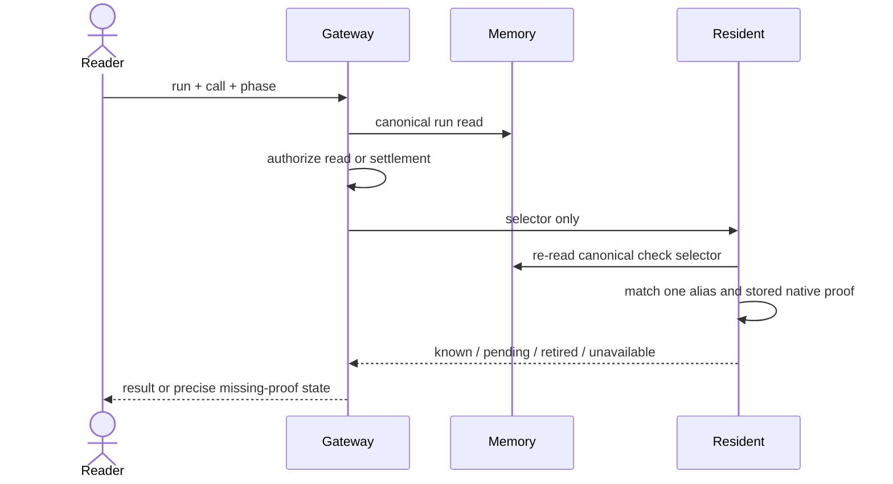

# Inspect and retire original recorded checks

Decision: adopt this bounded recovery design before implementation review. The delivery owner decides; the reader is an engineer new to recorded checks. The requested outcome is a supported original-operation read and proof-backed retirement, without running a command again or changing historical uncertainty.

A finished run currently loses its canonical check state when its live row is removed. A Resident alias can retain the original operation, but an operator cannot safely select it from a run and call. Retain the full bounded canonical check state, including any completed result, in private run evidence; use its selector to join an unresolved check to exactly one saved admission alias. Reads and retirement use different commands and permissions. Missing identity or native-ending proof remains unavailable; a terminal status never supplies it.

## Today at `3aa0b56c6615aa08d4f8e315e83aebaa5760fc1d`

| Fact | Evidence |
|---|---|
| Metadata and command identities are saved before dispatch, but finish removes live state; the workspace archive has no check-state field. | `src/core/checkExecution.ts`; `deploy/cloudflare-memory/worker.ts::finish`; `src/core/runLedger/workspaceDurability.ts::WorkspaceDurabilityArchive` |
| Private terminal producer evidence already lives in `runs.work_evidence_json`, with an in-memory counterpart. | `deploy/cloudflare-memory/worker.ts::upsertInTransaction`; `src/core/runLedger/inMemory.ts::finishedWorkEvidence` |
| A Resident admission alias stores the exact check key/hash, native key, thread, run, generation, fence and incarnation. There are at most64 phase aliases per thread. | `deploy/cloudflare-resident/checkOperation.ts` |
| Native recovery stores `{original, receipt}` under one exact key only after every original process is proven ended and the original record hash/owner still matches. Physical retirement preserves unknown historical effects instead. | `deploy/cloudflare-resident/nativeOperation.ts::recover`, `::retirement` |
| Run commands authorize a canonical visible run once. Runtime stops use a separate service capability. | `src/core/commands/runs.ts::getVisibleRun`; `src/core/runsService.ts`; `src/execution/runStop.ts` |

## Shape

This is a read-after-write receipt lookup, not a job retry. `runs.check` authorizes run visibility and selects run, call and metadata/command phase. The Resident receiver fetches that selector from Memory itself; it accepts no caller-authored owner, key, result or proof. The final receiver read returns a hash of the full frozen resource, thread, selector and saved operation identity. Gateway compares it to the one authorized source before exposing output; a changed live identity refuses. It finds one matching admission alias in the existing bounded thread inventory. `runs.settlecheck` uses the write policy and the same selection, then retires only that alias if the existing native-ended receipt verifies it. Neither command launches a process, sends a signal, resumes a model or changes the run's ending.

## Hard case

A fixture run saves command key K, then loses its response and finishes. Memory archives K from the fenced live state in the same finish transaction, never from the submitted final record. A later reader selects the original call; the receiver fetches K from Memory and finds one alias containing native key N and original owner tuple. If N has only a physical-retirement receipt, the read reports pending and settlement refuses. If N has an exact native-ended receipt whose original owner, thread and record hash agree with the alias, the read can report that ending without a write. An authorized settlement replaces only that alias with an ending tombstone, preserving K and N; it never invents command output or success. Repeating settlement reads the same tombstone, including after a lost write acknowledgement. This proves operation ending and no-repeat custody, not that assertions passed.

## Difficulty map

1. Original identity after live ownership ends: the canonical selector and exact admission/native receipt join below.
2. Terminal custody and bounded cleanup: retained source and tombstones below.
3. Existing command/store wiring: use the current seams; no alternate control plane.

## Original identity is a join, not an argument

Draft amendment 2026-10-14: the first independent reader identified missing schema, consistency and retention rules. These rules make the cross-store join explicit; the decision still refuses missing proof rather than inventing a migration.

| Source | Required identity |
|---|---|
| Canonical Memory selector | run id, user/requester, channel id, channel visibility, repository, thread/private-worker identity, call id, phase, saved key and command hash |
| One Resident alias | the same run/thread/key/hash, plus its saved generation, fence, incarnation, request digest and native key |
| Native ending archive | exact native key, original record, record hash matching that original, outcome native-ended, and terminal process tuples matching the original pending attempts |
| Retirement tombstone | original alias identities and verified ending digest; no fabricated output or success |

Memory copies check state and the complete authorization resource only from its owner-fenced live row, into existing private evidence. The copied resource includes run id, user id, channel id, channel visibility, repository and thread; submitted final records cannot supply or change it. Gateway compares the ordinary visible-run projection with this frozen resource before its single policy check; a mismatch is not_found. Private-worker thread filtering remains in force. For a current run, inspection reads the same canonical live source, without allowing settlement. It validates the selected check's run/requester/thread/repository and exact phase key/hash; malformed, missing or conflicting history refuses. The record's public projections do not gain stdout, private bindings or raw check state.

A live snapshot supports inspection only. Retirement requires a sealed terminal archive; it never consumes a mutable live preflight. The archive freezes each run/call/phase/key/hash identity at finish, and later final-record writes preserve it or refuse a contradiction. The Memory read is the selection linearization point: its frozen identity cannot change, although retention can later remove the source. No cross-store transaction or instantaneous revocation check is claimed.

The Resident resolves at most64 aliases under the canonical thread. Zero matches, several matches, changed key/hash or a foreign run/thread refuses. The alias supplies its original generation, fence, incarnation and native key because those fields were saved at admission; the caller cannot manufacture them. A proof read validates the stored native-ended receipt against its stored original record and exact hash, then compares the native owner/thread to the alias. The native ending archive and alias reside in the same Resident Durable Object storage. Read and validate both inside the settlement transaction, and write the tombstone only if the alias bytes, original hash and owner/thread still agree. Memory supplies the frozen terminal selection, not a mutable runtime grant. No second process is contacted, and Resident performs no native lookup or signal. A current registration is not substituted for a missing original identity, and physical retirement is not a native-ended proof.

Inspection is read-only. `known` means a saved canonical or Resident command result exists; it says nothing about assertions. `pending` means the exact alias exists but lacks an accepted ending/result proof, including physical-retirement-only cases. `retired` has reason `output_retired` when an existing tombstone has lost its payload, or `native_ended` when a validated ending receipt exists. Native-ended proof takes precedence over an output-only tombstone. Both retain unknown command output/effects rather than imply success. `unavailable` means canonical source, a unique alias, or required identity evidence cannot be read or verified. A known canonical completed result is display evidence only. The canonical state is bounded by32 command receipts plus one current preflight; output streams are already capped at4,000 characters. Its actual serialized bytes enter the existing run byte accounting, and the current request/body limits still apply.

Retirement returns an existing Resident result without replacing or deleting it. Otherwise it stores the original alias identities and proof digest, preserves missing output as unknown, and keeps a same-owner no-repeat tombstone. Only the existing strictly newer-owner cleanup can prune that tombstone. Other unknown aliases remain unchanged.

## Custody survives finishing

The finish transaction copies canonical check state to private terminal evidence before deleting the live row. Direct record puts cannot mint or replace this source. Later updates preserve existing selectors or refuse contradictions. Reads return unavailable when that archive is absent; old logs and timestamps are not a migration source. This change does not promise to restore output that existing eviction already removed. A canonical completed result remains displayable; when the canonical result is still unknown and the Resident payload is retired, inspection reports retired output without reconstructing it. Retiring one proven-ended alias does not reopen a terminal run or free a slot under the same owner.

Canonical evidence follows the existing run-history age, count and byte retention policy (`RunPolicy.retentionDays/maxRuns/maxBytes`); this proposal adds no minimum retention promise. Resident native-ending receipts currently have no TTL in the journal, but a full administrative rebuild can delete their storage. If Memory evidence expires, the selector is unavailable. If only Resident evidence is removed, a canonical completed result remains known; unresolved inspection and settlement refuse unavailable. Ordinary alias cleanup cannot delete native proof during settlement because the proof read and tombstone write share one Resident transaction; a full rebuild or newer-owner cleanup that wins first makes that transaction refuse.

## Why not the simpler alternatives?

**Copy every native receipt into Memory.** The proposed terminal archive retains completed check results already acknowledged in live state. Unresolved native endings originate in Resident and need its exact original journal, so copying them would add a second authority and a delivery/acknowledgement protocol; this bounded change reads the existing proof where it was committed.

**Infer ending from run status or a missing journal.** The model can stop while native work remains unknown, and physical retirement explicitly preserves unknown effects.

**Let the operator provide the key and owner.** That would turn lookup data into authority and allow a caller to select a different original operation.

**Clear all pending aliases or retry the command.** Both discard the only no-repeat obligation. Retirement is one exact key with existing proof.

## Boundaries and verification

No new process lookup/kill is added. The existing guarded native recovery can produce a receipt under its own authority; these commands only consume already-stored proof. Legacy runs without canonical selectors remain unavailable. Restored metadata cannot authorize dispatch at a changed checkout. Merge, deployment and live historical actions need their existing separate authority.

The source tests must prove canonical finish retention, forged final-record key/result and channel/visibility rejection, run-visibility refusal, exact phase selection, one/missing/multiple alias cases, both store implementations, native proof/hash/owner mismatch, physical-retirement refusal, read-only inspection, one-key retirement, lost-ACK readback and same-owner no-repeat behavior. Living criteria belong in `coding-checks.md`, `run-history.md` and `resident-repos.md` with exact test references in the implementation change. Live acceptance remains a gap until the containing release and an authorized original-key fixture are verified.

## Implementation refinement 2026-10-14

The command is `runs.settlecheck`, keeping the existing command grammar. A restart archive is explicitly unsealed and cannot authorize retirement. The next claimed owner restores its original checks; a later state cannot drop prior call identities, and final finish replaces the unsealed snapshot. Provisional generic history puts never capture check authority. A sealed archive is immutable; later generic records cannot supply `checkArchive` or `checkExecutions` fields. Invalid canonical check state or combined UTF-8 record/evidence overflow refuses finish before deleting live evidence. The actual private evidence JSON participates in the stored byte count, and retention refusal rolls back the finish transaction.

The native archive does not independently contain incarnation or request digest. Those are immutable saved admission facts associated with the exact native key. The accepted native proof independently checks that key, original record hash, original owner/thread and process identity/ending tuples. No historical value is reconstructed or compared to a replacement runtime.

Terminal custody applies to ordinary finish, hard-stop completion and expired unclaimed restart closure. Cancellation validates and preserves the same original checks; a custody failure after native control has ended retains cancellation and live evidence rather than repeating control. Unclaimed restart closure seals only the already captured source. Existing metadata cleanup after a definite pre-admission refusal remains permitted. Partial exit124/137/143 output is not completion proof and remains retained until an exact native ending permits a tombstone that still contains those bytes.

Abandon adds only a negative guard: recorded or unreadable check evidence prevents deletion. An absent or strictly empty unstarted state remains eligible. This path mints no archive or native control authority.

Restoration compares the complete original authorization resource, including channel and visibility, before admitting a replacement claim. Current live checks apply the same guard before a same-generation restart can mutate phase or metadata. The runtime initializes its check producer from the canonical restored owner state even when the restart carries no resume context. An unreadable tracked source is an unknown-outcome hold, not a missing-capability response that permits shell fallback.
