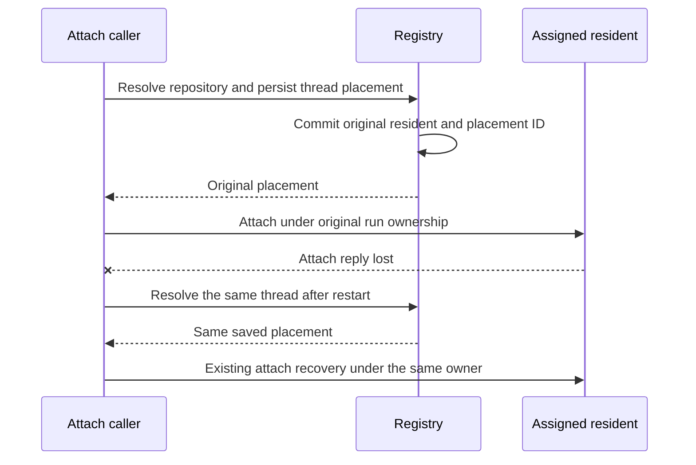
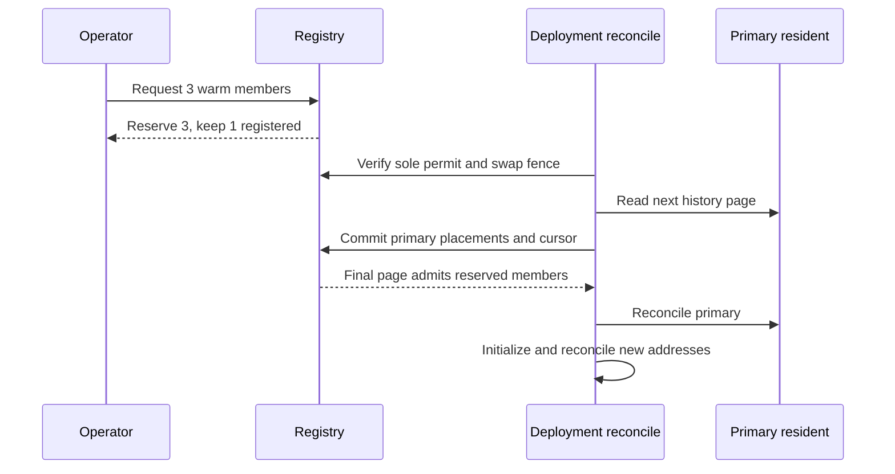

# Durable thread placement across warm resident replicas

The Resident maintainer should adopt durable thread placement before enabling several warm replicas of one repository. This record is for an engineer new to the execution layer. The requested outcome is `n` warm residents for a repository, with existing work preserved when capacity changes and each operation routed to its original resident.

Each resident-enabled repository currently has one resident with at most sixteen active owners. Persisting one repository/thread assignment before attach lets additional residents accept new work without moving old work. The cost is durable placement storage and replica-aware lifecycle operations. Begin by recording the existing primary resident; enabling extra replicas follows only after routing, migration and fleet lifecycle checks pass. Stronger descendant containment remains the existing hard-stop investigation's responsibility and is not a prerequisite for recording placement.

Amendment on 2026-10-14: the primary-recording and address-protocol slices are implemented at `98011039f2e46d4dba7ccea6a4f8686a0e160725`. The current decision is to adopt fixed warm pools with activation under the existing deployment fence. The fleet amendment below replaces the earlier open migration protocol and defines lifecycle retries. It does not approve production activation.

## Today at the surveyed commit

| Constraint | Owning source |
| --- | --- |
| The repository resource is also the Sandbox identity. All threads for one repository reach the same instance. | `deploy/cloudflare-resident/shared.ts::residentStub`; `worker.ts::resolveThreadRoute` |
| Attach looks up repository registration; ordinary data routes omit that lookup but retain registry-backed deployment admission. | `worker.ts::resolveThreadRoute`, `withThreadBusy`, `withDeployAdmission` |
| The registry admits five resident repositories; the deployment template allows ten instances. A resident admits sixteen active owners independently of historical UID allocation. | `worker.ts::RESIDENT_CAP`, `reserveWorkloadSlot`; `shared.ts::RESIDENT_WORKLOAD_LIMIT`; `wrangler.template.jsonc` |
| The refresh Workflow identity uses the repository and time bucket. Idle residents can park. | `src/execution/residentInstanceId.ts::refreshInstanceId`; `worker.ts::refreshGate` |
| Workspaces and cancellation already bind original run ownership and physical container identity. That does not yet identify a replica independently of the repository. | `src/execution/resident.ts::ResidentBinding`; `worker.ts::cancelRun`; `runRegistration.ts` |

Cloudflare documents [explicit instance IDs for horizontal scaling](https://developers.cloudflare.com/containers/configuration/scaling-and-routing/). Its random router serves stateless instances. Our workspaces are stateful, so selecting a fresh destination per request is incorrect. Platform support for several containers is established; stronger in-VM process containment is a separate question.

## The shape

Use a durable assignment table, like a scheduler that records a job's chosen worker before launch. Unlike a disposable job, a thread can keep private workspace state between runs, so its assignment has no inactivity expiry. The repository remains the authorization and command-configuration identity. The resident ID becomes the physical routing address, while the existing kernel identity distinguishes successive VMs behind that address.

The first source slice records `{schema, resource, threadKey, residentId, placementId}` in the existing registry. The primary resident ID remains the repository resource, preserving current DO identity and stored work. The random placement ID is allocated before the transaction and saved once; it identifies placement only and supplies no run authority or shutdown proof. The table uses a prefix outside repository registration so it cannot consume fleet slots.

## The hard case

Thread `mcp:default:review-a` belongs to `repo:acme/api`. The registry commits its placement on the primary, but the acknowledgment is lost. The caller receives an error and does not contact a resident. A later request reads the same row even if a second replica has since been added. If the reply was instead lost after resident attachment, the same destination lets the existing owner and native-operation rules decide recovery. Placement does not retry a model run, repeat a native submission or prove that an earlier attach failed. The invariant is one durable destination per repository/thread, not exactly-once execution.

## Immutable assignment before attach

The registry reads repository registration and the placement row in one storage transaction. An absent or metadata-only repository refuses placement. A new row selects the existing primary during the first slice. Current HTTP validation bounds the resource to 63 characters and thread key to 161 characters, so each tuple key is bounded. The total historical thread count is not yet measured; the activation controller must report the complete binding count and encoded placement storage size before pool rollout. An existing well-formed row returns unchanged; a malformed row refuses without repair or overwrite. A transaction failure returns failure before resident work. A stored address unsupported by the current router also refuses instead of silently falling back to the primary.

No TTL, release call or idle sweep deletes placement. Releasing an active run is separate from moving its thread workspace. Single-resident removal can retain address metadata because that metadata alone authorizes nothing. Complete pool offboard deletes placements only after all members confirm cleanup. Re-onboarding still uses the same primary address; it does not assert that an old VM or worktree survives. A future move needs an explicit, fenced custody transition and is outside the first pool version.

Once extra replicas exist, the registry selects among registered, serving members for an unassigned thread and persists the choice before submission. The chosen resident still owns atomic workload admission. A full or unhealthy destination does not by itself justify moving a thread. For a fresh run that does not require a retained workspace, the first pool version keeps the resident assignment and permits the existing snapshot-seeded per-run sandbox fallback. A resumed run that requires its original private workspace must wait or refuse on that resident; fallback does not move those files. The first pool version never changes the assignment after a refusal. Supporting reassignment later would require proof that no workspace or native admission was created. This trades some utilization for a smaller ownership protocol. The fallback runtime keeps its own existing run identity and never counts as a successful resident attach.

## Cutover without moving existing work

Amendment on 2026-10-14: the fixed-pool amendment below supplies the concrete import protocol. It replaces the earlier open synchronization question. Every existing thread identity must be imported on the primary before secondary placement begins, including evicted bindings and incomplete attachments.

The first address protocol checks each explicit address against saved placement on every request, beside the existing deployment permit. Legacy data requests can use the primary only when the thread has no secondary placement. Missing or changed expected addresses refuse on recovery. Replica IDs never replace repository authorization.

## Fleet integration

Store repository registration once and list its resident members separately. New replica IDs are opaque, bounded Sandbox IDs rather than repository aliases. Count physical replicas against the fleet cap, and reject configuration exceeding the deployed container ceiling. Refresh Workflow IDs, mutable snapshot metadata, restore selection, readiness, metrics, drain, rebuild, offboard and cancellation address the exact replica. Immutable backups may be shared only when their existing content and ownership contracts permit it; the first implementation keeps each replica's mutable metadata separate.

A configured warm minimum must suppress idle parking for those members and retain refresh intervals below the sleep window. Reducing the desired count drains excess members of new placements but cannot destroy them while assigned work or preservation obligations remain. Start with a fixed count, default one; autoscaling and live workspace migration add no value to the first proof.

## Alternatives and boundaries

**Why not hash the thread over the replica count?** Changing the count remaps existing work. Stable hashes still need durable exceptions for removed or unavailable members, which is the placement table.

**Why not raise the owner or UID limit?** That adds no CPU, memory or disk to the current VM. Historical UID allocation is already dynamic.

**Why not wait for perfect Kill?** Replica placement does not change per-run execution or claim new containment. Keep conservative admission and shutdown evidence. The hard-stop owner can improve managed processes or add an in-VM scope behind the same resident address. A later choice to use one VM per run would require re-evaluating pool execution, not pretending placement had already qualified that architecture.

## Adoption and proof

Amendment on 2026-10-14: primary placement recording and replica-address propagation are implemented. Fixed-pool source tests and a disposable two-member rehearsal remain the adoption gates described below. The existing deployment owner controls activation. Local tests do not establish serving capacity or descendant containment.

## Amendment: first replica-address protocol

Re-evaluation on 2026-10-14: the proposed direction remains immutable placement before execution. This protocol implementation verifies explicit replica selectors against registry placement on each routed request. This adds a placement lookup beside existing deploy admission rather than assuming a new per-resident placement trust store. The extra lookup is bounded and provides one authority while the pool is introduced. A later optimization must preserve exact address matching before removing it. Address fields remain optional for legacy-primary clients; after any new client records them, missing or changed fields fail closed on reattachment. The fixed-pool amendment below defines secondary provisioning and legacy-client refusal.

## Amendment: fixed warm pools and deployment-fenced activation

Re-evaluation on 2026-10-14: immutable placement remains the accepted direction of this proposal. The next source slice uses the existing post-upload deployment fence to import old thread identities before new member addresses become eligible. This trades immediate scale-up for one existing maintenance boundary. It does not move old threads, increase per-VM workload limits, or change native termination evidence.

At `98011039f2e46d4dba7ccea6a4f8686a0e160725`, `worker.ts::beginDeployReconcileAdmission` permits an uploaded Worker to reconcile while the swap fence stands. Ordinary resident work, refresh steps, fleet lifecycle requests and the watchdog retain durable deployment permits. `replicaMaintenanceFence` requires reconciliation to hold the only permit. Each import commit also requires the same fence tuple (`since`, `until`, `swapVersion`, `swapAt`) and a still-live drain. Each permit is persisted before its protected operation and removed only after that operation settles; a missing completion reply retains the original admission until readback resolves it. A pre-fence request retains a permit and blocks activation. Old Worker reconciliation cannot cross the version fence. A second post-upload reconcile permit also blocks an import commit rather than claiming exclusive admission.

The source contract covers creation of new thread identities, not every metadata write:

| Writer | Why enumeration cannot miss a new identity |
| --- | --- |
| Attach, UID allocation, run registration and run fence creation | `attachThreadTraced::withDeployAdmission` spans reservation through binding/registration commit. A prior permit blocks import; a later request cannot acquire a permit under the swap fence. |
| Deadline update, retained-owner reconciliation, detach, discard and ordinary commands | Each uses `withDeployAdmission` or `withThreadBusy`; retained-owner reconciliation requires an existing binding. |
| Refresh sweep, watchdog and mutating admin routes | `runInstanceStep`, `runWatchdog` and `withFleetAdmission` hold their permits through awaited mutation. |
| Cancellation | It can update an existing binding but requires that binding and registration; it creates no new thread identity. |
| Lazy UID migration and scheduled provisioning | These are not registry-admitted. `uidOwnership.ts::stateOf` copies identities already present in the retained legacy array; `resetUidGeneration` retains old indexed ownership. Import includes both forms, so behind-cursor copies duplicate an identity covered elsewhere. |

This contract is verified against the surveyed predecessor and the current source. An arbitrary older deployment without these admission guards is not a qualified migration source. The deployment owner must establish the predecessor's capability before the disposable rehearsal.

The normal deployment requests a 90-minute drain: a 60-minute wait plus a 30-minute margin (`src/deploy/residentDrain.ts::drainBody`, `src/core/budgets.ts::DRAIN`). The API default is 60 minutes and maximum is 90 minutes. Fence creation requires at least 20 minutes left. Import has no separate TTL; it uses the remaining live drain, which a later image hold can shorten to ten minutes. Each page rechecks the live deadline rather than assuming the full requested window remains.

The registry stores one ordered member list per repository. The primary is first; additional addresses are random, bounded Sandbox IDs. A requested count reserves all new addresses against the existing five-resident cap immediately. A later lower cap does not prevent a lower warm count or warming addresses already retained by the pool. `active` counts addresses admitted to lifecycle management, not ready or awake VMs. A pending member is not listed for execution, watchdog initialization or readiness until import completes. Readiness and serving probes establish each member's later state.

### One interrupted scale-up

For `repo:acme/api`, the operator requests three warm members. The registry retains the primary, reserves two addresses and replies with one registered member. During the next post-upload reconcile, the primary must report zero executing and zero unknown runs. Reconcile reads all primary storage in pages of 128 keys and imports the union of thread bindings, evicted bindings, run registrations/fences, dynamic UID ownership and legacy UID spends. Partial attaches therefore cannot disappear from placement history. The importer takes thread keys from `thread:`, `runReg:` and `runFence:` key suffixes, and from `thread:` owner values in UID rows or legacy spends. It deduplicates their union. An invalid thread key, malformed UID owner or saved placement on another resident refuses activation; the importer never repairs conflicting evidence.

A legacy ownership row can contain more than 256 thread IDs. Reconcile imports each storage page in chunks of at most 256 threads. Each registry transaction verifies the pool revision and the full fence tuple, then writes that chunk's primary assignments. Only the final chunk advances the storage cursor; only the final chunk of the last page activates members. A lost intermediate reply replays the same storage page and keeps earlier assignments. A lost final reply reads the committed cursor. A changed fence restarts enumeration from the beginning because writes could have occurred between windows. The final page admits every reserved member in the same transaction. Reconcile then initializes and checks each admitted member at its own address. The deploy runner also requests reconciliation for pending members when the uploaded container application is unchanged; a Worker-only release must not skip activation. Failure after activation leaves registered members unready; readiness retains the deployment hold, and lifecycle retries address the same members. No failure chooses new addresses for old threads.

Historical key count and import duration remain unmeasured. The deployment owner must record them in the first disposable two-member rehearsal. An import that outlives the fence refuses its next commit and leaves pending members inactive. This bounds authority rather than claiming a fixed migration duration. The highest-risk source invariant is complete import under that fence; local rollback, cursor restart and exclusivity tests cover the protocol, while Cloudflare's actual cross-version behavior remains live qualification.

### New placement and exact-member operations

Capable attach clients advertise replica routing. The Worker probes desired active members for serviceability, workload seats and memory, then the registry selects a new destination round robin and commits it before attach. Disk admission remains local to the selected member. If eligibility changes after the probe, placement stays fixed and existing refusal or new-run sandbox fallback applies. Legacy attach uses the primary, and a legacy data request for an existing secondary placement refuses. Status and recovery use the recorded address. An explicit address is checked against saved placement on each data request; execution authority still comes from the original run, owner fence and kernel checks.

Refresh, snapshot cleanup, image reports, deployment readiness and the dashboard use physical member addresses. The primary retains its legacy Workflow ID; secondary refresh IDs contain their unique address. Desired members bypass idle parking. Excess members after a lower requested count receive no new placements but can serve old threads and use ordinary idle parking. Their addresses still count against capacity; this version has no individual-member retirement or live migration.

Pool rebuild, full reset, debug and native-operation recovery take a 1-based member number through dedicated replica endpoints. Dedicated paths make older Workers refuse instead of silently ignoring a selector. The thread placement pair remains a separate execution protocol. Whole-repository offboard is the only operation that tears down every member.

### Removal must survive retries

Offboard first closes the registry record to new placement and automatic lifecycle admission. That transaction requires the same pool revision read when the request began; a delayed request cannot adopt a replacement pool. It keeps the catalog and all placements until every admitted member has a removal receipt. A member removal runs under the existing per-DO recreate lock and rereads the exact offboarding pool revision before destruction. This prevents an old delayed request from destroying a newly onboarded primary. A concurrent retry returns busy; it cannot certify cleanup.

Removal persists retirement before teardown. Teardown keeps the resident address, retirement marker and cleanup intent across storage cleanup, then removes that member's R2 prefix. The registry stores the removal receipt before cleanup confirmation clears the intent. A lost reply recovers the same receipt and confirms cleanup without another destroy. A stale watchdog cannot initialize a retired address; explicit primary onboarding can clear its retirement after the original removal completes. Only complete receipts allow paged deletion of placements and final catalog removal. A native operation's historical outcome remains unknown unless its own existing evidence resolves it.

This lifecycle routing is the largest implementation change. It stays in the same source slice because activating extra members without per-member readiness, maintenance and cleanup would expose unmanaged capacity. The separate hard-stop effort retains process containment and original native-owner accounting. Its workload-audit producer can later use the same generic member selector; no duplicate audit framework belongs here.

### Alternatives and qualification

Consistent hashing still moves stateful threads when membership changes. Immediate activation before import can send an old, currently evicted thread to a new resident. A second custom migration lock would need every old and new caller to honor it; the deployed swap fence already spans those paths. Raising the active-owner limit buys no additional VM resources. These alternatives do not remove the migration or custody requirements.

Local tests must cover reserved capacity, pending-member refusal, rollback and resumed import, unchanged old destinations after downscale, distinct refresh IDs, warm-idle behavior, per-member readiness and cancellation routing, partial cleanup, concurrent offboard and stale lifecycle requests. The deployment owner then qualifies two members in a disposable scope, including a resumed original thread and an unaffected sibling during cancellation. Only that receipt supports production enablement. A downgrade to code that assumes one resident is unsafe after secondary placement; rollback must retain replica-aware routing and close new placements instead of discarding the catalog.
