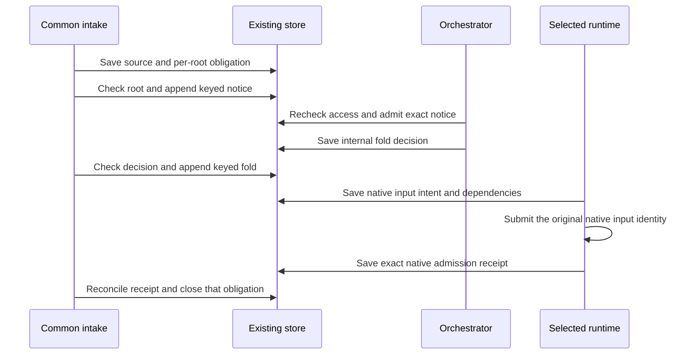

# Admit source input through the existing inbox

Adopt this contract before connecting source delivery in steps 2 and 3 of the [shared intake plan](2026-10-14-003-feat-shared-message-handling-execution-plan.md). The reader is an engineer new to this path. Producer activation requires the integrated proofs below; adopting this record does not enable it.

## Decision

Use the existing source jobs, keyed inbox and context checkpoints to carry external evidence. First deliver a **source notice** to the verified orchestrator. Only that orchestrator can select an **internal fold** for another run or unit. Both inputs retain their source type and current access requirements. Add exact native input receipts because an inbox receipt cannot prove runtime admission. This extends the existing storage and recovery path; it adds no delivery scheduler or agent-specific handler.

The difficult case is a restart after the native runtime accepted input but before the host saved its acknowledgment. A timeout keeps that input unresolved. The host reconciles its original identity; it does not resend it based on matching text or start another run.

## Today at `4d0f3534c784d711d07860db88504bc3351306fa`

| Fact used by this decision | Source |
| --- | --- |
| Version 2 source events have a complete receipt and common text or facts. Version 1 has only native payload. Jobs retain relevance results, leases and bounded retries, but no per-destination delivery or native admission result. | [sourceEvents.ts](../../src/core/runLedger/sourceEvents.ts), [sourceEventJobs.ts](../../src/core/runLedger/sourceEventJobs.ts) |
| An internal source-fold decision retains source, input, context and target hashes. The evidence message requires that decision, so it cannot be the first notice. | [orchestratorDecisions.ts](../../src/core/dispatch/orchestratorDecisions.ts), [sourceEvidence.ts](../../src/core/runLedger/sourceEvidence.ts) |
| A keyed inbox receipt can be checked against an exact stored row witness. It does not prove native admission. | [inboxDelivery.ts](../../src/core/runLedger/inboxDelivery.ts) |
| Pi confirms follow-ups by normalized text. OpenCode has a stored-row fallback that matches text. Neither is exact source-input correlation. | [Pi harness](../../src/core/harness/pi/harness.ts), `steerEchoed`; [OpenCode harness](../../src/core/harness/opencode/harness.ts), `learnRow` |
| `LedgerRun.step` returns `Promise<void>`. Its return alone is not a durable checkpoint receipt. | [writeThrough.ts](../../src/core/runLedger/writeThrough.ts) |
| The shared provider guard exists, but `runLoop` installs its source callback only for an initially private or media-bearing run. | [runLoop.ts](../../src/core/dispatch/runLoop.ts), `bindSourceGuard`; [modelProxy.ts](../../src/channels/modelProxy.ts), `door.sourceGuard.check` |
| Context references retain source runs for existing run, session and unit holders. The Worker does not recognize source-job obligations as holders. | [contextRetention.ts](../../src/core/runLedger/contextRetention.ts), [Memory Worker](../../deploy/cloudflare-memory/worker.ts), `contextReferences` |

## One path, two input types

This is a transactional outbox and inbox consumer. The additional constraint is that each consumer must still have current access to the source.

The adapter verifies and normalizes a native event. Common intake matches its stored identities to task contexts, checks source access and runs the existing relevance filter. Intake writes a notice only to the canonical orchestrator inbox. The orchestrator can ignore it, use it, or save a fold through its existing owned decision writer. Common delivery then verifies that decision before writing an internal input. A source author supplies data, including when the author is the requester. The author supplies no execution or confirmation rights.

The relevance filter calls `RouteModel` directly, outside an agent run's provider guard. Extend its existing attempt boundary to use the same source-access verifier before every model call, including correction attempts. Recheck the source and task-context snapshot when a queued call reaches provider admission. Revoked, changed or unavailable proof holds the classification without sending source bytes. A check before the first attempt cannot authorize a later correction call.

A notice needs no prior fold decision. Requiring one would prevent the orchestrator from seeing the input it must classify. A worker accepts only an internal fold. The ordinary requester decoder continues to refuse both source input types.

Legacy version 1 events remain held until their adapter supplies a verified common-content projection. Common intake cannot infer text from the opaque native payload or invent a version 2 event under the old receipt.

## Restart after native acceptance

Suppose event `s1` reaches root `o1`. The root selects child `r1` with decision `d1`. Keyed delivery creates inbox row 8. The runtime saves an input intent for row 8, submits it, and stops before it records the native response.

The next owner first reads the existing delivery receipt. It receives row 8 again, not another append. It then reads the original input intent and the native session using that intent's identity. An exact native row plus a committed checkpoint permits acknowledgment. Missing, ambiguous or unsupported proof after submission keeps the original obligation held. An intent that was saved but never submitted can proceed only when the original transport contract proves no prior effect. A pending submission counts as uncertain; a local flag cannot prove absence. Identical visible text in row 9 cannot settle row 8.

If source access was withdrawn, the next owner holds the whole context. It does not remove the comment and reuse a summary derived from it. The original row, owner, input intent and uncertain outcome remain available for authorized recovery.

## Hard parts

1. Exact native admission after an uncertain write. This needs adapter capability proof in both runtimes before delivery can be enabled.
2. Access after context changes. A source dependency must survive summaries, checkpoints, reuse and compaction.
3. Atomic delivery and retention. The checked source, root, decision and destination must still match when the store appends input.

## Exact input identity and completion

Extend the existing runtime input and checkpoint records with a versioned source-input entry. It retains the destination run or unit, original owner coordinates, source receipt, notice or fold kind, decision reference for a fold, exact inbox witness set, rendered-input digest, native session identity and native input identity. Save this intent before a native submission. A process generation fences the current writer; it does not replace the original input identity after reclaim.

Each adapter must demonstrate a durable identity that survives its normal restart and can be read back without text matching. A command response ID alone is insufficient unless the native contract binds it to the saved input. If the pinned runtime lacks that contract, the adapter remains disabled. Do not change an SDK or accept a text marker as proof to bypass this gate.

Save the native admission receipt through the existing checkpoint writer and verify its committed canonical readback before advancing the exact witness set. An uncertain write retains the intent and obligation. A high-water inbox cursor cannot acknowledge unrelated rows or gaps.

Keep these results separate:

| Result | What the system can claim |
| --- | --- |
| Keyed inbox delivery | One stored destination row with its original receipt |
| Durable native admission | The exact input exists in the original native session and canonical checkpoint |
| Provider request or agent result | Only what its own request or result receipt proves |

The source job's routing obligation ends at verified durable native admission, or an explicit terminal disposition such as unrelated or permission refused. Call this result `native-admitted`, not model consumption. It does not prove a provider saw the input or that an external action succeeded. The original run retains responsibility for model execution, pending effects and its final result. A notice acknowledgment does not settle any selected child fold; each fold has its own obligation.

## Current access follows the whole context

Extend `ContextDependencies` with source references and fold-decision references. A leaf binds the complete source receipt, canonical source-access identity, original requester, root and selected decision when applicable. Validation reloads canonical records and applies current adapter access policy. Missing policy, changed identity, revoked access and unavailable proof hold the context.

Install the existing shared provider guard before a source-capable run can accept input, including a public run that starts without source data. The guard reads the cumulative dependency set on every provider admission. Reuse the existing context validation and change-detection loop. Preserve existing owner, audience, media, destination and history checks. Do not create a separate model guard for each harness.

Admission, summaries and native checkpoints retain these dependencies. Model-backed compaction uses the shared provider gate. Reuse and resume validate the whole dependency set before model admission. Removing one source leaf cannot make its derived summary public. Automatic restoration after revocation is outside this contract; recovery needs the original custody and fresh access proof.

For GitHub, the adapter checks the verified host, App installation, numeric repository identity and PR identity against the task's stored relationship and current App access. Preserve the existing requester and destination policy too. This includes the actor's repository grant, verified audience, bound user and fresh person-level repository permission wherever the original task requires them. App visibility or a repository name match alone permits no disclosure. The common path receives a checked identity and policy result, never App credentials. Other adapters implement the same access seam with their native identities.

## Canonical joins and stable projections

The canonical root is the original orchestrator run, identified by its run ID, requester ID, channel ID and thread key. Use `canonicalHandoffRunOf` to read those stored facts and `orchestratorOwnerForHandoff` to verify the root role: agent `orchestrator`, with no parent run or instance. An inherited child link must reproduce that root. Missing, malformed or ambiguous legacy links hold input. A notice cannot start a new root after the old run ends. Retain its conversation obligation until existing lifecycle policy explicitly admits continuation; do not route it to a specialist.

Define versioned canonical projections in the existing decision module:

- Root: original owner coordinates and verified root role.
- Destination: run ID and owner coordinates, or instance, unit, original task identity and selected active attempt. Reclaim alone does not change task identity.
- Task context: verified native source relationship, repository and PR identities, selected head when relevant, and context revision. A new head or changed context needs a new orchestrator decision.
- Input: source receipt, notice or fold kind, and the canonical common content. A fold also binds its decision identity and destination projection.

Exclude process generation and transcript position from these hashes. Do not exclude a selected attempt or head that changes the action's meaning. Exact replay returns the original receipt even after the target ends; it grants no present permission to consume the input.

Capture immutable projections before asynchronous checks. Inside the append transaction, compare current canonical source, root, decision and destination with those checked projections. A change holds the append. Prefer live history when present; malformed live history cannot fall back to an older completed record. A remote access check is not atomic with local storage, so consumers recheck access before source bytes enter a model.

Render common content deterministically. Preserve text state and exact text, including empty strings and null. Facts use canonical JSON. Deleted or withdrawn content stays typed and cannot become a requester instruction. Native payload remains opaque outside the adapter. The input digest covers this complete typed projection, not display text alone.

## Pending obligations and retention

Extend the existing source job with one obligation per matched root and selected fold. Save its stable identity, checked context revision, delivery receipt, native intent, admission receipt or terminal disposition. Waiting for a recipient or reconciling an unknown acknowledgment does not consume operational retry attempts. Operational failures retain the existing bounded retry policy. Use the shared alarm and due calculation; create no new scheduler.

Adopt a **seven-day automatic recovery window** from source reception. This is a proposed product limit, not a measured capability. Save it with each obligation. After that deadline, stop automatic delivery, mark the coverage gap and retain unresolved evidence for explicit recovery. Expiry does not mean consumed, no effect, or safe replay.

Pending and uncertain obligations are retention roots. Extend the existing context-reference index with a source-obligation holder. Create its local pins in the same transaction as the obligation. For records in another storage object, use the existing acknowledged range-protection protocol before committing the holder. This is ordered protection, not a cross-object transaction. Unknown protection or holder writes retain the original intent for reconciliation.

After native admission, prove that the consumer's committed checkpoint owns the required dependency pins before releasing the job's pins. A committed terminal disposition can release them only when no unresolved effect remains. The deadline alone releases no pins. Reconcile orphan pins against canonical obligations and their original protection receipts; an unreadable or uncertain holder stays protected. Never turn a missing acknowledgment into an orphan deletion.

This can fill storage when many obligations remain unresolved. Refuse new input rather than evict retained proof. Limit a source event to 16 root obligations, reusing `SOURCE_RELEVANCE_MAX_CONTEXTS`, and each root to 16 selected folds. The fold limit is a proposed bound. Excess matches or folds remain an explicit capacity gap; never truncate them and report complete coverage.

Current event and inbox limits alone do not bound obligation, pin and checkpoint storage. Before accepting an obligation, the existing store must charge its bounded metadata, protection records and retained source records, and reserve capacity for its maximum settlement or refusal receipt. Uncertain reservations remain charged. Before activation, measure the complete retained workload and define the operator action for held capacity. A seven-day automatic window does not promise indefinite admission or silently delete older unknowns.

## Alternatives and activation gates

**Use the saved decision as permission.** It proves an earlier selection, not current access or the current destination. **Use the inbox receipt as completion.** It identifies a stored row, not a native input. **Deliver directly to the matching worker.** Source matching cannot select a worker on the orchestrator's behalf. **Add a delivery service.** It would duplicate the existing job, inbox and alarm ownership without solving native correlation.

The next behavior change updates the affected rows in [run history](../reference/specs/run-history.md), [thread admission](../reference/specs/thread-admission.md) and both runtime specs. Keep producers and delivery callers disabled until these proofs pass:

| Required proof | Current state and resolver |
| --- | --- |
| Canonical notice and fold; altered source, destination and decision; concurrent task/head change | `[gap]` Shared intake implementation through both stores |
| Two identical-text inputs, restart after native acceptance, uncertain checkpoint and exact witness acknowledgment | `[gap]` Both pinned runtime adapters; capability proof precedes activation |
| Revocation before a queued relevance call or correction attempt, after native input, in a public run receiving later evidence, and across summaries, resume and compaction | `[gap]` Shared access verifier, relevance-attempt boundary and provider guard integration |
| Pending pins survive pruning; terminal settlement releases only eligible pins; capacity refuses new input | `[gap]` Existing retention and source-job integration |
| Ended root, legacy context and mixed-version reader preserve pending input | `[gap]` Existing lifecycle and reader-first migration |
| Disposable end-to-end source delivery with measured limits and original custody | `[gap]` Release owner qualification after integrated source and current-head review |

Each gap belongs to the original shared intake work. Component storage tests and merged converters do not close these integration gates.
