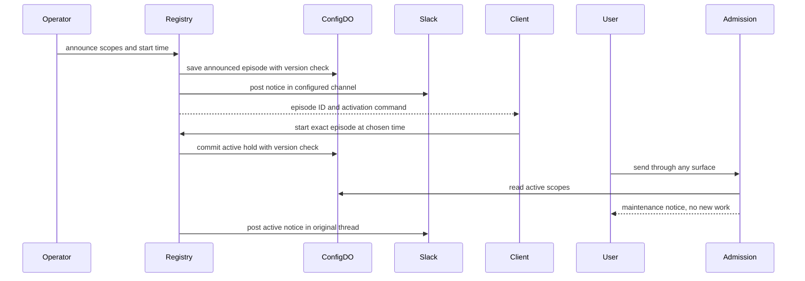

# Scoped maintenance with client-owned scheduling

Assumed decision: adopt this design before implementation. Reader: an engineer new to this area. Justin owns the product scope.

The operator must be able to announce maintenance, block selected capabilities through CLI or MCP, and restore access explicitly. All-access maintenance must render a maintenance page on the public site. Notices must identify unavailable actions, use one Slack thread, and omit recovery estimates. The client owns any timer.

One durable **episode** holds the selected scopes and its state: announced, active, or ended. The existing state Worker stores it with a version check. Every admission path reads that state without a positive cache. This costs a state read at each boundary but keeps Slack, MCP, HTTP and internal dispatch from disagreeing after a restart. The existing deploy drain cannot serve this purpose because it closes the Slack socket and hands work to another process.

## Today at `c314913b6`

| Fact that affects the decision | Source |
| --- | --- |
| One registry derives CLI, MCP, HTTP and chat commands. | `src/core/commands/all.ts`, `src/core/commandCatalogue.ts` |
| Native organization admission can accept work before dispatcher execution. | `src/core/organization/service.ts::admit`, `src/channels/browserHomeInstallation.ts` |
| The bot shim starts the container for ordinary public requests. It also serves some routes itself. | `deploy/cloudflare/worker.ts::fetch` |
| ConfigDO already stores arbitrary JSON documents with compare-and-swap versions. | `deploy/cloudflare-memory/worker.ts::ConfigDO`, `/config/get`, `/config/put` |
| Deploy drain permits work handoff to the next generation. | `src/index.ts::drain` |

## The shape

This is a durable admission switch, similar to a service maintenance flag. Unlike a process drain, it stays active when the bot restarts. `maintenance announce` records the scope and notice timing. `maintenance start --id <episode>` activates that exact episode. `maintenance end --id <episode>` restores access. `maintenance status` reports durable state, notice delivery, and current work in flight. Immediate start can create an episode without a prior announcement.

The caller receives a scheduling handoff, not a claim that Switchboard installed a timer. If the client misses its wake, the episode remains announced and access stays open.

## The difficult case

An operator announces resident maintenance for 5 PM PDT and gives the client the episode ID. A second operator ends that episode before 5 PM. The old client then calls `start` with the old ID. The command refuses the ended episode; it cannot close a newer episode or reopen the old one. A delayed `end` also cannot clear a newer hold.

If Slack fails after activation, the durable hold remains active. The response reports the notice as unverified. A retry reads the saved phase and does not post the same notice again. An explicit `update` can post a new message to a verified thread. If the root post has an unknown outcome, status preserves that uncertainty and the operator must reconcile it in Slack.

## Difficulty map

1. Cover all admission paths while keeping recovery available. See Admission and existing work.
2. Preserve exact episode identity across client delays and concurrent operators. See State and notices.
3. Serve the public outage page without starting the bot. See Public routes.

## Admission and existing work

Scopes are `all`, `agents`, `residents`, and `web`. `all` closes user admission and web pages. `agents` closes new agent work on every surface. `residents` also closes all new agent work, including sandbox fallback, plus deterministic repository execution. This conservative scope prevents an alternative executor from bypassing resident maintenance. `web` closes public pages while leaving CLI and MCP available.

The shared command registry applies the hold after ordinary authorization. Maintenance commands and status remain available. Existing authorized read and stop controls remain available for operators who hold `maintenance:write`; a maintenance grant never adds another command's permission. Resident administration remains an operator repair path under its existing grant.

The enforcement points are explicit because a dispatcher-only flag would accept receipts and miss routes served by the Worker.

| Path | Enforcement point | Active hold | Recovery exception |
| --- | --- | --- | --- |
| Slack channel requests, direct and child dispatch, resumed work | `dispatch`, before routing | `all`, `agents`, `residents` | Typed channel commands use the registry gate |
| Native Slack DM, HTTP, MCP and browser receipts | `OrganizationService.issue/admit` | `all`, `agents`, `residents` | Existing receipt reads retain their normal checks; private Slack requests and clicks remain closed; use CLI or MCP for recovery |
| CLI, MCP tools, HTTP API and typed chat commands | `CommandRegistry.invoke`, after authorization | `all`; resident test/build; agent steering and rebase | Maintenance and status; reads, stops and resident repair for a maintenance operator |
| Saved command approval | Registry on execution | Same as typed command | A maintenance end can still execute |
| Saved agent approval | `dispatch` on execution | Same as new agent work | Cancel remains available |
| Public pages and unknown paths | Worker and bot HTTP gate | `all`, `web` | Health, command/MCP transport, authenticated approval page and existing-work callbacks |
| HTTP ingress and GitHub webhook | HTTP gate before forwarding | `all`, `agents`, `residents` | No new request is accepted |

The first implementation adds one state round trip at each applicable boundary, with a ten-second timeout per read. A public request can cross both the Worker and bot checks. Added p95 latency is unknown. The initial acceptance target is less than one second of added p95 latency on staging; a slower result requires a new design decision before live activation. The uncached reads are deliberate: a cached open answer would admit work after an operator closes access.

The command exception predicate is exact: `maintenance.*` and `status.show` remain available after normal authorization. An actor who passes `authorize(maintenance:write)` also retains commands with `effect: read`, `runs.stop`, `plane.stop`, and `action: repo:write`. Other commands are refused under `all`. `steer.run` and `pulls.rebase` are refused under an agent or resident hold. `repo.test` and `repo.build` are refused under a resident hold. Web-only holds do not change command access.

The dispatcher checks before routing. Organization admission checks before accepting a receipt. Confirmation execution checks again so an old confirmation cannot start new work during a hold. The edge blocks user routes before forwarding to the bot. Read failures fail closed when a durable maintenance store is configured. A request that passed an earlier check but reaches a later check after activation is refused there. A request past its final check is existing work.

Existing work can finish. Maintenance does not kill processes, erase leases, settle unknown operations, or prove that a resident is idle. Status reports work in flight and explicitly requires separate resident workload proof before resident repair. A request that passed its admission check before activation is existing work. Operators must inspect it or stop it through the existing controls. No status response claims exclusive access or a safe-to-destroy state.

## State and notices

ConfigDO stores one document under `maintenance`. Announce, start and end use its version as a precondition. A conflict refuses the write; it does not overwrite a competing operator. Start and end require the episode ID when they act on a saved episode. An active episode has no expiry. The bot passes its shared store into the catalogue. The local CLI lazily builds the same store from its configured state Worker; connected CLI commands call the hosted MCP catalogue. Local CLI notices without a Slack binding remain unverified.

The announcement channel defaults to `switchboard-dev` and can be set for another installation. The Slack adapter resolves the name to an ID and stores the root message and thread link. Follow-up notices use that root. Messages name the blocked actions and tell readers to follow the thread. The scheduled start uses an offset-bearing timestamp, rendered in Pacific time. An unscheduled announcement uses the operator's timing text, with `in a few minutes` as the default. No message or schema has a recovery ETA.

The state transition commits before its notice. A durable `sending` status reserves the notice and prevents a second normal phase transition or update from overtaking it. A completed delivery saves `sent`; a failed or lost delivery saves `unverified`. If the writer dies or its receipt cannot commit, `sending` remains visible and is not expired automatically. An operator can use `end --without-notice` to restore access without a new post. That explicit recovery warns that an earlier notice can still arrive and makes the operator responsible for Slack correction.

Both a confirmed delivery failure and a lost acknowledgement prevent automatic reposting. The operator checks the channel and posts any needed correction in Slack; the tool cannot attach an uncertain root to the episode. A verified root supports further explicit updates. Notice delivery is not a transaction with Slack.

## Public routes

The bot Worker reads the same state before it starts or forwards to the container. Active `all` or `web` maintenance returns a standalone HTML page with HTTP 503 and `Cache-Control: no-store` for public pages, including unknown paths. JSON callers receive a structured maintenance error. The page escapes operator text and links only to a verified Slack thread URL.

Health probes, MCP, command endpoints, `/settings/approve`, and authenticated internal callbacks retain their existing handlers. They are recovery or existing-work paths; their normal authentication remains required. MCP and command invocations apply the same admission policy inside the bot. The maintenance control plane depends on the state Worker remaining available. A state Worker outage returns a generic 503 at the edge, rather than stale open state.

## Why not just use deploy drain?

Deploy drain closes Slack and hands runs to another generation. It neither stores an operator hold nor supplies a public outage page. It can reopen service on the next request.

## Why not put a timer in Switchboard?

The user already has a running client with a scheduling mechanism. Returning an exact activation call avoids a second scheduler, timezone policy, and recovery owner. There is no automatic start or end.

## Rollout and proof

Ship the bot and shim together against the existing ConfigDO document API. Before live use, prove the same episode blocks Slack, MCP, HTTP, browser and child dispatch, survives restart, leaves operator recovery available, and keeps the page available while the bot is unavailable. Focused local tests cover state transitions, stale IDs, notice failure, command authorization, admission refusal and edge rendering. Live deployment, real Slack delivery and resident idle proof remain separate operator checks.
