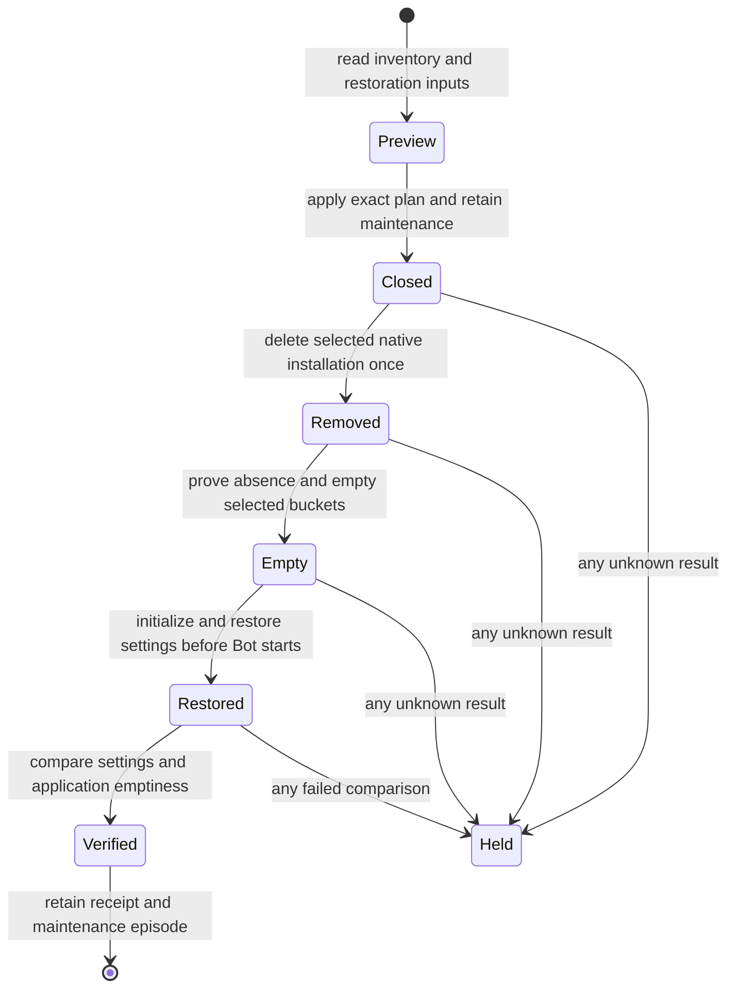

# Repeatable installation reset

Adopt one plan/apply reset command for an installation. The operator selects the account and reviews its inventory before applying it. This record is for an engineer who knows Cloudflare Workers but has not read the reset investigation. Production execution requires a later human instruction.

The command must show its deletion scope without changing service state, remove application history and native execution state, retain configuration and access, and prove the result on isolated staging before production use.

The installation has more state than its run index. A resident rebuild leaves the shared Registry, and staging recreation leaves R2 objects. The reset will extend installation recreation rather than pretend that a loop over run deletion produces an empty deployment. It will preserve settings and credentials in a separate private journal bucket, remove the selected native installation and application-owned bucket contents, and use the existing first-install path to create fresh namespaces. This costs downtime and requires complete restoration inputs before the first deletion. Cloud provider logs, billing and metrics retention remain outside application-state deletion and appear explicitly in the plan.

## Today at `d877e30f3580a7e9652cf0d95d9f73fd2afa20fd`

| Fact | Evidence |
| --- | --- |
| Recreation already plans native applications, Workflows, Workers and owned namespaces, rejects foreign dependencies, and stops after an uncertain mutation. | `src/deploy/stagingRecreate.ts::planStagingRecreation`, `::recreateStaging` |
| First installation proves native absence, creates provisional Memory, publishes a fresh owned config slot and then verifies the Bot and full Memory bindings. | `src/deploy/stagingBootstrap.ts::initializeStaging`; `scripts/staging-initialize.ts::initializeOnHost` |
| Maintenance closes admission but permits existing work and does not freeze alarms or other writers. | `src/core/maintenance.ts`; `docs/how-to/maintenance.md` |
| Credentials and runtime overrides share ConfigDO. Identity bindings and source policy share OrganizationDO with runtime intake rows. | `deploy/cloudflare-memory/worker.ts::ConfigDO`; `src/core/identity/sqlite.ts`; `src/core/organization/sqlite.ts` |
| Artifact and resident backup buckets are separate. SDK backups have keys outside the resident prefix. | `deploy/cloudflare/wrangler.template.jsonc`; `deploy/cloudflare-resident/wrangler.template.jsonc`; `deploy/cloudflare-resident/worker.ts::deleteBackupObjects` |

## The shape

The command is an installation rebuild with a private settings transfer, similar to restoring configuration into an empty database. It does not transfer run history. The preview records exact native ownership, data objects, storage scope, settings and restoration prerequisites. Apply checks that plan again, retains a closed maintenance episode, removes the old installation, proves native absence, clears the planned buckets, recreates the installation, and compares preserved settings before reopening is allowed.

## One failure trace

The operator previews the four staging Workers and the two staging buckets. Apply rechecks their exact account, IDs, dependencies and settings digest. Maintenance is active and the remaining agent work has finished. The script saves settings privately and writes its removal phase before deleting an application. The provider times out on that original deletion. The script records an unknown result and ends without another deletion, bucket cleanup, initialization or reopen. A later inspection can reconcile that original action; rerunning apply cannot silently treat the partial installation as a new complete plan. The trace proves that repeatability does not mean automatic replay after an unknown destructive result.

## Where this can be wrong

1. Configuration can be lost or access can reopen during restoration. See **Preserve access while replacing namespaces**. This is also the most work.
2. Incomplete or foreign storage can be included in deletion. See **Select the whole owned installation**.
3. An uncertain provider result can be replayed. See **Keep one original execution receipt**.

## Preserve access while replacing namespaces

Deleting all namespaces also deletes runtime settings that do not live in the infrastructure repository. A reset therefore requires a private, bounded transfer of the settings that are needed to preserve access. It retains runtime overrides, sealed MCP credentials, personal tokens, identity bindings and source-access policy. It excludes action confirmations, OAuth connection tickets, organization queue/receipt history, learned memory and transcripts. The credential encryption key and all Worker secrets must come from the existing secret source, with the original installation account and identities.

The transfer retains the active maintenance episode. The initializer restores it into provisional Memory before creating a Bot that can receive requests. An empty Resident watchdog returns without a work record. The fresh Registry therefore stays empty until registration restoration, and Resident needs no second Worker upload while those repositories start. It publishes the selected static configuration through the existing canonical config-publication protocol; old publication snapshots are history and are not restored. It then restores the saved runtime settings and identity/access state before starting the Bot. Identity revision and source-access cutoffs must retain their meaning when their old streams are absent; the transfer keeps their monotonic sequence bounds and clears runtime leases and cursors.

The transfer contract is version 1 and has a 2 MiB UTF-8 JSON limit. ConfigDO retains non-publication configuration documents, sealed secrets and personal tokens. It excludes tickets and confirmations. OrganizationDO retains directory people, person bindings and binding receipts, plus organization rows of kinds `state`, `binding-cutoff`, `revoked-source`, `source-delete`, `source-policy` and `source-policy-index`. A restored organization state keeps its identity, access revision, source-policy revision and stream sequence. Its general revision and wake/reconciled sequences restart at zero; its lease and lane cursor become null. A state with no access revision, source-policy revision or stream sequence is empty runtime state and is omitted. Routine refresh claims and completions therefore do not change the settings digest. Binding rows and their revisions, source policies and cutoffs remain part of that digest. A new stream entry starts above the retained stream sequence. For cross-identity history, a binding cutoff at sequence 100 still excludes entries at or below 100 and permits a new entry at 101; a person's own entries retain their separate access rule.

Maintenance alone is not a write barrier. Apply first requires the exact all-scope maintenance episode and zero active reviews. ConfigDO and OrganizationDO install SQL triggers that reject inserts, updates and deletes on their settings tables, in the same transaction that records the original reset operation ID. The Registry uses its KV transaction to acquire a durable lock; each registration mutation checks that lock inside its write transaction. The triggers also reject a write from a request that entered before the freeze and later resumed. After every selected settings object confirms that lock, the operator reads their settings again and compares the digest with the preview. A difference stops before native deletion; the captured locked settings remain available for inspection. Preview never installs a lock. A lock has no expiry and is not automatically removed after a failure. Native recreation removes it with the old namespace.

The preflight also compares the selected configuration and complete deployed secret-name roster with the restoration source. It authenticates every retained sealed MCP credential with the supplied encryption key without logging plaintext; matching secret names alone do not prove that the key is correct. Missing secret values, authentication failure, unknown settings schemas, changed access inputs or a transfer above the 2 MiB limit refuse before deletion. No credential value enters a plan, public receipt, CI artifact or log. The operator encrypts the private transfer with the original MCP credential key and binds it to the account, operation and plan. The local file has mode 600. Before native deletion, the controller stores that encrypted file in a separate private R2 journal bucket and reads back the same bytes. A failed readback stops deletion. The separate journal bucket retains encrypted records across resets and runner disposal. The original credential key stays in the original secret source. Restored ConfigDO records the reset operation as `restoring` and rejects a maintenance-end write until that original operation records verified restoration. Reset itself does not reopen the service.

Restoring an arbitrary old snapshot into a running installation is not supported. The receiver requires an empty target and exact transfer identity. A partial restore remains held and cannot be replaced by another snapshot. Local tests must prove literal settings and access survive and old confirmations cannot execute.

## Select the whole owned installation

The profile supplies the account, four script names and artifact bucket. The resident template derives its backup bucket as `<resident-script>-cache`. Complete native inventories must prove each selected application and namespace belongs to those scripts and that no foreign consumer depends on them. Exact selections and source/configuration hashes enter the plan. The creation config retains deployed variables, observability, limits, container CPU/memory/disk capacity, instance ceilings and cron schedules. Before deletion it checks storage/service bindings, declared custom domains and disabled development endpoints. Origin and routing checks use each Worker's zone override or the global zone, while retaining account and exact-domain ownership checks. Unsupported placement, container command/network changes, external bindings, extra domains or legacy URL routes refuse. Runtime health counts and newly issued domain certificates are not configuration. Unknown dependency fields or incomplete pagination refuse; names alone are not ownership proof.

Bucket inventory covers the entire selected bucket, including SDK `backups/` keys. A shared or unproved bucket refuses deletion. Apply lists the approved buckets again after native removal, deletes each listed key once, and independently lists both buckets to prove emptiness. Approval covers whole buckets, including data that arrives after preview. A changed bucket name or native ownership scope invalidates the plan. Each object deletion has an append-only, flushed intent record. D1, KV or other persistent bindings are reported and refuse execution until a supported adapter covers them. The command does not guess that an unbound account resource belongs to this installation.

Native removal ends the old container and Workflow namespace before application state is replaced. Unknown old command outcomes remain unknown in the external receipt; their history is discarded only under the selected reset scope. The new installation cannot reuse old namespace IDs. A zero active-run count alone is not this proof.

## Keep one original execution receipt

Preview is read-only. Apply takes the exact plan SHA-256 and an explicit account pin. It refuses an existing execution receipt, a changed plan, force flags, a dirty source tree, missing preservation input or active reviews. Each destructive action is written to the local receipt and sealed into a unique record in `<memory-script>-reset-journal` before dispatch. The controller verifies remote bytes before sending the action. The final held or verified record contains the complete local log, and every earlier intent survives a runner crash independently. Apply creates this control bucket only if absent; an authenticated owner marker, disabled public endpoints, no runtime Worker binding and no automatic deletion rule are prerequisites. Preview only reads these facts. The journal bucket is excluded from application-data deletion. The runner does not retry a mutation after timeout, malformed response or an unknown acknowledgment. It leaves maintenance closed and the original phase available for inspection.

The same command can reset the newly verified installation later by producing a new preview and a new receipt. It cannot resume an incomplete reset merely because the operator ran the command again. Reconciliation is a separate read-only action until the original result is known. The operator lists records with `installation:reset --list-receipts`, downloads the selected encrypted key with `--download`, and decrypts it with `--inspect`, keeps the original source and operation IDs, and compares the journal's last intent with native resource lists and receiver status. A partial restoration has no automatic continuation in version 1. It requires an operator-authored recovery using that original packet and the existing first-install checkpoint rules; a new reset command is refused. This is a production readiness limit, not a successful reset or permission to replay. No outage target has been set; the staging rehearsal measures elapsed reset time and reports it before production eligibility.

## Why not the smaller alternatives

**Why not delete runs or rebuild each resident?** Those operations leave session logs, learned memory, shared admissions, native sandboxes and R2 backups. They do not satisfy a fresh application deployment.

**Why not clear every SQL table in place?** ConfigDO and OrganizationDO mix settings with history. Active isolates, alarms and pending writes could restore deleted rows. Replacing the selected native installation avoids assuming those writers are idle.

**Why not use staging recreation unchanged?** It rejects production by design, does not clear buckets, and requires separate restoration input. Its ownership and first-install methods are reused without weakening its staging-only entry point.

## Staging proof and remaining questions

The rehearsal uses the separate staging account and the existing shared deployment lock. It must not replace a running candidate or clear its obligations. Seed disposable run/session/memory data and objects in both buckets, including an SDK-style backup key. Save literal runtime settings and access fixtures. Run preview and prove no state changed. Apply the preview, prove old native IDs and application rows are absent, prove the settings fixtures survive, then run the existing bounded product smoke. Repeat with a new plan and receipt. A deterministic local test injects an uncertain deletion and proves that no later phase runs.

The reset APIs must already be deployed in Memory and Resident before preview. An older deployment refuses without a service mutation; this command does not bypass ordinary deployment gates to install them. Production requires a released build, a main-branch manual controller and a later human execution instruction. The reset writer owns the following open proof: the provider must permit the existing native removal order and first-install path for the actual staging stack. The staging rehearsal resolves it before production eligibility. Production read/write access remains a separate prerequisite, not a reason to change credentials or bypass a denial. Provider-retained Analytics Engine data, logs, billing and recovery retention are named exclusions; a fresh metric dataset would be a separate configuration decision.

The covering living contract is `docs/reference/specs/installation-reset.md`. The same change must bind preview, preservation, refusal, removal, bucket cleanup, restoration and staging acceptance criteria to executable proofs. Local proof, current-head review, CI, staging reset, and any later production execution remain separate receipts.
