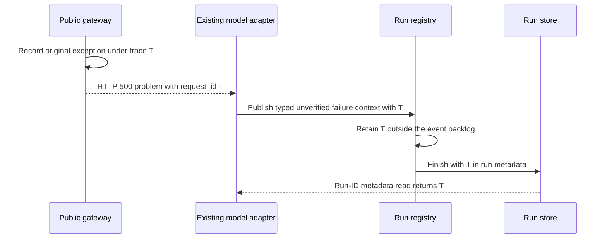

# Shared request failure context

Adopt the shared request failure contract before implementation. The maintainer requested this repair. Reader: an engineer new to the request boundary.

Amendment, 2026-10-18: the maintainer requires a core request contract, with existing error serialization moved to its neutral owner. Use one generic request-failure problem and one failure context. Do not add a gateway-specific diagnostic system.

A run-ID metadata read must return the originating gateway failure reference after event eviction and storage reload. The repair must preserve error evidence, credential redaction, trace isolation and retry rules.

The core request-failure contract will bind the existing request trace, the operator exception and the HTTP problem. The public gateway will use that contract for every routed throw. The installed model adapter already retains a problem's `request_id`; its producer will attach the shared failure context once. The core append path will retain it and the finish writer will save it in the existing run metadata. This adds one bounded reference per affected run and no new store or retry path.

## Today at `e66d2a6f49e44ce78649d6707066b8692df7ec8e`

| Fact | Source |
| --- | --- |
| The public gateway strips inbound trace context, creates a root and rethrows routed request errors after recording the root. | `deploy/cloudflare/worker.ts`, `src/core/trace/workerTrace.ts` |
| The Responses adapter retains structured HTTP problem details, including `request_id`, as unverified diagnostic evidence. | `src/core/harness/pi/bridge.test.ts::retains problem details from the installed Responses adapter without treating them as recovery authority` |
| Model failures are events, so their evidence can leave the bounded registry backlog. | `src/core/runEvents.ts`, `src/core/runRegistry.ts::publish` |
| The ordinary run-ID read loads a stored summary without its events. | `src/core/runsService.ts::getRun` |
| The existing exception serializer retains bounded, redacted class, message, stack, flags and causes. | `src/core/runStateWriteDiagnostic.ts::captureException` |

## The shape

Use an HTTP problem document as a reference to the request's existing trace. The reference is diagnostic data, not authorization. The shared request boundary owns exception reporting; the registry owns the last observed failure context; the existing history writer owns persistence. The point read returns that stored reference directly. It does not reconstruct it from events or ask the log service to discover it.

## A control-object disconnect

A request sends an untrusted trace header to the public gateway. The gateway discards it and creates trace T. Its control-object fetch throws before a response is returned. The gateway reports the original exception once and returns a generic HTTP 500 problem with `request_id` T. The adapter emits its existing unknown model-failure diagnostic. The registry retains a validated reference to T even when later events evict that diagnostic. After the run is saved and a new reader loads it, one run-ID summary read still returns T. The diagnostic stays unverified and permits no retry.

## Difficulty map

1. Preserve the public trust boundary and the original exception while returning useful diagnostic data. See Request ownership.
2. Preserve the last reference independently of event eviction and without a read-time scan. See Stored reference.

## Request ownership

The single request-failure problem type is `urn:switchboard:request-failure`. Its HTTP status is 500 and its `request_id` is the root's 32-character trace ID. It contains no original exception prose, headers or request bytes. The shared request-failure function logs the original exception through the existing bounded serializer. Extract that serializer into a neutral module because both storage and request boundaries now use it; retain the storage module's exports for compatibility. The root still records timing and HTTP status. If the primary operator reporter fails, its existing trace sink records a reporter-failure marker and only the already-sanitized capture. That fallback is capped by the trace sink and does not prove full exception or durable log capture. Raw decoder prose must never enter the fallback. The response remains a failure.

Only the existing outer catch changes. Explicit HTTP responses, including 401, 403 and 503, pass through unchanged. That catch currently rethrows every exception and Cloudflare returns HTTP 500; it contains no status-bearing HTTP exception translation. The shared contract preserves that 500 status. It adds no attempt and does not re-run a forwarded request.

The gateway must not adopt a caller's trace parent or infer a run ID from a bearer. A caller-supplied problem can resemble the gateway problem, so the stored reference explicitly remains unverified. Reading that trace still requires operator authorization. The reference never changes failure classification, model recovery or tool replay.

## Stored reference

The exact reference shape is `failureContext: { traceId: string, source: "unverified" }`. The trace ID is 32 lowercase hexadecimal characters and must not be all zero. The reference serializes to 68 ASCII bytes. The projection accepts only the shared problem type, status 500 and a valid `requestId` from the existing normalized adapter diagnostic. Unknown fields, credentials and error prose do not enter the reference. A null field records an observed failure whose origin is unavailable; an absent field means no projection was recorded.

The producer attaches `run_note.failureContext` through the shared problem decoder. The core append path projects that generic field once, before backlog trimming, without inspecting model diagnostics. Live publication and resumed replay use the same projection. Publication sequence, not the producer's timestamp, defines the last observed failure. A later such event replaces the reference; if the producer has no valid shared request-failure problem, it attaches null. For example, failure A names trace T, then failure B has no origin ID. Keeping T would falsely attribute B to A's request. The field describes the latest failure, so B must leave it unavailable. Older event evidence remains subject to its existing retention contract.

Snapshots copy that field into the terminal record. Reclaimed record assembly can project from the retained events it already loaded, at write time. The ordinary metadata reader returns the stored field from the existing summary row, with no event read. A crash before final persistence can recover only retained canonical evidence; the contract does not reconstruct an evicted historical identity. Legacy rows have no reference. Private event projection retains only the validated structural context while removing the original model diagnostic and its prose.

The exception serializer caps message content at 512 characters and stack content at 1,024 characters, plus an ellipsis when truncated. Causes stop at depth two. Its existing redaction and decoder-prose rules remain unchanged.

The constant-time claim covers association and retrieval of the retained field without event scanning. Remove the unnecessary registry snapshot copy from metadata reads. Existing live-ledger discovery and development-store retention can still depend on the number of live rows or stored summaries; the production summary endpoint is a keyed read. The receipt must state those limits rather than claim that every existing service operation is constant time. Fetching an external trace has its provider's own query cost.

## Alternatives and boundaries

Adding a request ID only to an event leaves the evidence subject to eviction and requires a scan. Timestamp matching cannot establish exact identity. Accepting inbound trace parents would weaken the public boundary. Automatic retry would require a separate authority and outcome argument. None is part of this repair.

## Validation and delivery

Use the actual gateway handler and installed Responses adapter with an injected control-object disconnect. Persist the resulting reference through the history writer, evict its event, create a new reader, and assert that the run-ID metadata read returns the exact original gateway trace without reading events. Add boundary cases for forged trace parents, secret-bearing exceptions, malformed references and a failed operator reporter. Run scoped types, lint, format, spec and hygiene checks, then CI and native review. Deployment and live acceptance remain separate.

The harness must use its existing structured unknown-failure emission during wind-down as well as ordinary and follow-up turns. Keep the wind-down outcome and safe user message unchanged; retain the same diagnostic beside that message.
