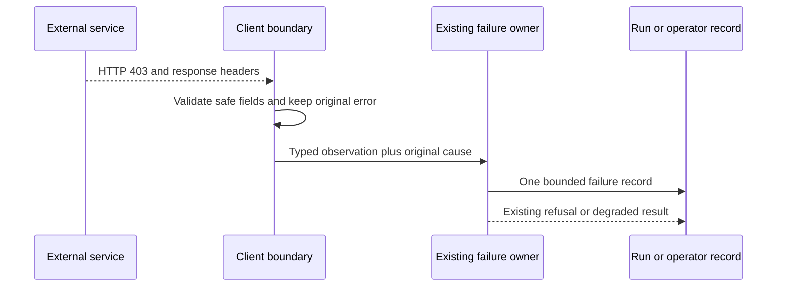

# Retain safe evidence from external service failures

Adopt a response-evidence rule for each external service client. This record is for an engineer new to Switchboard's service boundaries. The maintainer asked for details beyond HTTP 403 across all external services. The maintainer chose a separate audit and small service-specific PRs, with safe fields and a redacted, capped provider message when one is available.

Success means that a run-linked failure keeps the response facts its client observed, an operation without a run keeps those facts in its existing operator record, and a call with no response says so. No observation grants a retry, access, merge or deployment.

Switchboard already keeps bounded model-provider errors, but other clients can report only HTTP status or silently return an unknown result. A 403 can mean a GitHub permission refusal, a primary rate limit or a secondary rate limit. The bet is to record **one safe observation at each external client's existing failure boundary**. Each client records only fields it observed and keeps its original error, refusal and retry rules. Reuse `redactAndCap` and existing diagnostics first. Add a common parser only after two clients need the same policy. A global logging hook would miss SDK errors and the caller's degraded result. This audit is open until every outbound call site has an owner, a response/no-response rule and proof.

## Today at `32647860ee26a6fc573e35a5ad53447c6c2573b6`

| Fact | Source |
| --- | --- |
| The model proxy records a bounded, redacted failure with status, provider code or message, request ID, selected headers and response fields. | `src/core/provider.ts` (`safeProviderDiagnostic`), `src/channels/modelProxy.ts` (`recordFailure`) |
| [Review run `e2c12a5c`](https://switchboard.coreplanelabs.dev/runs/e2c12a5c-07f8-473c-8c4d-3296cfb19ffc) spent 30,598 ms in a model source check, then retained `github-repositories`, HTTP 403 and a code location, but no GitHub response ID or rate-limit evidence. | Run events 195 and 196, read through Switchboard MCP on 2026-10-21 |
| The GitHub REST client keeps status and a validated request ID on `GithubApiError`, but a model source-check record drops that ID at this base. [PR #3425](https://github.com/coreplanelabs/switchboard/pull/3425) adds the source-check fields and a redacted JSON message; it is a separate change and is not part of this audit base. | `src/execution/githubApi.ts` (`GithubApiError`), `src/core/dispatch/sourceCheckError.ts` |
| Some GitHub PR helpers return `undefined` on non-2xx; the check reader can throw with status only. | `src/execution/githubPulls.ts` (`if (!res.ok) return undefined`), `src/execution/githubPrChecks.ts` (`PrChecksUnavailable`) |
| The Brave Search and JWKS clients throw status-only errors; the model catalogue reader returns a status-only note. | `src/tools/web.ts`, `src/channels/accessAuth.ts`, `src/core/dispatch/providerModels.ts` |
| Forty-four non-test files under `src/` and `deploy/` call `fetch`. This count includes internal Worker calls and does not include SDK traffic such as Slack. | `rg -l '\bfetch\(' src deploy -g '!*.test.*' -g '!*.spec.*'` at this commit |

## Shape

Treat a service response like a receipt: the client records what it received, and the existing run or operation owner stores that receipt with the failure. The receipt differs from a wire capture. It has a closed service and operation, a kind (`http`, `transport`, `decode` or `sdk`), and only the fields valid for that kind. HTTP and decode kinds have a status; transport has none. An SDK kind has status only if the SDK exposes it. The provider message is one redacted, capped line when the client can isolate that field. The model proxy keeps its existing richer, redacted error record.

## One hard case

Review run `e2c12a5c-07f8-473c-8c4d-3296cfb19ffc` reached the saved GitHub repository check. Its model source span started at event 195 and ended 30,598 ms later at event 196 with `github-repositories`, HTTP 403 and `context_exception`. The record does not contain the original GitHub request ID, rate-limit headers or response message, so this run's 403 cause is unknown. Under the proposed contract, the same client would record only validated response facts it actually received and the redacted JSON `message` when present. If GitHub sent `x-ratelimit-remaining: 0`, the record would show that count; if its documented message indicated a secondary limit, the client would map it to `secondary-rate-limit-indicated`. Neither fact is asserted for this historical run. The source-check owner would save the observation with the failure and still refuse model access. If the fetch threw before headers, it would record `transport` with no HTTP status. This trace shows the property the contract buys: original evidence without an invented cause or replay authority.

## Difficulty map

1. Provider-controlled response bytes can contain private paths and credentials. See Safe facts.
2. An SDK or transport can hide the HTTP response. See Missing responses.
3. The clients have different failure owners. See Coverage.

## Safe facts

The outbound client validates and caps facts before any run event, operator log or user-facing error receives them. It never copies a raw header bag, body or URL into the observation. Common fields have fixed bounds: HTTP status 100..599; request ID at most 64 ASCII identifier characters under a service-specific pattern; rate-limit remaining 0..1,000,000,000; reset time 0..4,102,444,800 UTC epoch seconds; Retry-After 0..604,800 seconds; service, operation and provider code from closed tables. A provider message is isolated from structured response data, reduced to one line, redacted with known credentials and private URLs removed, then capped before it leaves the client. `redactAndCap` removes known credential shapes but does not remove URLs; each service PR must add and test its own URL policy and message cap. If the client cannot make a message safe to retain, it records that the message was omitted and keeps the other observed fields. The client omits an unparseable body rather than treating it as a message. Unknown or invalid fields are omitted. A failed diagnostic leaves the original error and refusal in place. A service-specific parser may map a documented response code or message to a closed reason such as `secondary-rate-limit-indicated`; an unknown reason stays unknown. The original exception remains in process for control flow. The existing model proxy keeps its richer, redacted diagnostic.

This beats logging full responses because redaction cannot prove an arbitrary body safe, and a copied `Retry-After` value or error sentence cannot authorize recovery. It also beats status-only logging: HTTP 403 alone does not distinguish permissions from rate limits. Diagnostic serialization failure must not change the original failure or the refusal.

## Missing responses

The client records `transport` when no response arrived, `decode` when headers arrived but the body could not be read, and `sdk` when the SDK supplies a structured code without the HTTP response. Missing status, request ID or headers remain absent, with the kind explaining why. A local authorization refusal is not an external-service failure. The run owner never promotes an SDK message or a returned HTTP 200 error body into a provider cause without its existing authentication and parsing checks. A deliberate degraded result stays degraded but keeps its failure observation; it must not look like success.

This beats a global `fetch` hook. A hook misses Slack SDK errors and cannot decide which run or operation owns a response. It can also log expected 404s as incidents or record a response after its caller has already chosen a safe degraded result.

## Coverage

Each external client keeps its current error and retry policy. The table records the observed failure edge at this base, not a claim that every call in a file has the same behavior. Run-linked failures use their existing event owner; background operations use their current structured operator log. The call-site ledger below names the unresolved work. No new global telemetry stream is part of this decision.

| Service and caller | Failure owner and observation at this base | Gap and next proof |
| --- | --- | --- |
| Model providers: `modelProxy.ts::recordFailure`, `provider.ts::safeProviderDiagnostic` | Run note keeps bounded status, provider type/code, request ID, selected headers and redacted message across Anthropic, OpenAI Chat and OpenAI Responses wires. | Keep the existing richer contract; no smaller common adapter. Retest each wire if serialization changes. |
| GitHub source REST: `githubApi.ts::request` → `sourceCheckError` | Client error has status and validated request ID; source-check span drops most response facts at this base. | [#3425](https://github.com/coreplanelabs/switchboard/pull/3425) adds bounded rate-limit fields, closed reason and redacted JSON message to the original run. Its current-head CI, Review and deployment are separate. |
| GitHub PR and check readers: `githubPulls.ts`, `githubPrChecks.ts::load` | `githubPulls.ts` has 35 direct fetch sites; several non-2xx branches return `undefined` or `unverified`. The check reader's 403/429 rate branch drops the status in its error and sets `blockedUntil`; a failed branch-rules read can become a warning and snapshot. | Audit each of the 35 sites against its operation owner. Preserve unknown and warning results, but attach observed status, request ID and safe message. Prove that a 403 does not become a permission verdict or extra retry. |
| GitHub App and native door: `githubApp.ts::githubJson`, `::resolveGithubDoorToken`, `githubComments.ts`, `authorBinding.ts`, `repoContext.ts`, resident Worker token mint | `resolveGithubDoorToken` redacts its body, but `githubJson` and resident token mint copy raw response text slices into errors. | Remove the raw-text paths first, then record one safe observation at each token/read owner. Keep mint failure distinct from a GitHub permission denial. |
| Slack Web API and file download: `slack.ts::describeError`, `slack/attachments.ts` | `describeError` can log an unbounded `Error.message` or JSON object; `retryAfter` controls a resend timer and does not enter that log. File download logs HTTP status or a raw transport exception. The SDK may not expose a response. | Bound and redact current log text first. Retain only observed SDK/status/rate-limit fields and a safe message at the owning run or operation. Prove the existing resend limit remains. |
| Slack OIDC: `linkProofSlack.ts::json` | Any non-2xx becomes `provider unavailable`, with no status in the error. | Keep the proof refusal, add safe status and response reason to its owner, and never log the token response. |
| Cloudflare state Worker: `storageTransport.ts`, `storageFailureDiagnostic.ts` | Request-bound storage failures keep operation, phase, digest, request ID and observed HTTP status. | Keep this contract; prove the remaining state call sites preserve no-response and decode distinctions. |
| Cloudflare sandbox and resident: `cloudflareSandbox.ts`, `factory.ts`, resident Worker | Sandbox stores `lastErr` from an arbitrary `data.error` string, with status; it retries 5xx. | Replace unbounded response prose with a redacted capped message and typed observed facts. Verify the existing retry and refusal rules. |
| Cloudflare account API and deploy: `src/deploy/run.ts`, Worker preflight scripts | Several non-2xx paths return `HTTP ${status}`; `/exec` copies 200 raw response characters. `deploy/cloudflare/preflight.mjs::fetchHealth` includes a full URL and raw response slice or transport exception. | Remove raw text and URL from errors first. Keep the deploy operation as owner; add safe parsed message, status/request ID, and transport-versus-HTTP evidence. |
| Depot CI API: `deploy/cloudflare/depotCi.ts::rpc` | On non-2xx it keeps `upstreamStatus`, cancels the body and throws `upstream refused`. | Preserve mutation uncertainty and the current retry fence. Capture only safe response fields before body cancellation; prove no failed mutation is replayed. |
| Brave Search and arbitrary web fetch: `tools/web.ts` | Brave throws status only; `web_fetch` returns status in tool text. | Treat Brave as a provider failure with safe message. Arbitrary pages are content, not a trusted provider error; retain status and URL-safe context, not their raw bodies. |
| Cloudflare Access JWKS: `channels/accessAuth.ts::httpJwksFetcher` | Non-2xx throws `JWKS fetch failed: HTTP ${status}`; verification fails closed. | Keep authentication closed. Record safe status/request correlation at the auth owner; prove response text cannot become a key or a logged secret. |
| Model catalogues: `dispatch/providerModels.ts`, `commands/providers.ts` | A non-2xx gives a status-only note or error. A transport or decode throw copies raw `err.message` into model-facing or command text. | Bound and redact current exception text first. Keep the degraded catalogue result visible as degraded and add safe response detail. Never present cached/configured refs as a fresh provider result. |
| Hosted MCP: `setup/hostedClient.ts::hostedMcpCall`, `::proxyHostedMcp` | `hostedMcpCall` parses JSON without first checking `response.ok`. `proxyHostedMcp` parses a reply body, but a notification returns before checking HTTP status or body. | Retain HTTP status, a redacted capped error message when structured, and an explicit no-response or decode result. A failed notification must not look like successful delivery. Preserve JSON-RPC failure semantics. |
| Other outbound clients: `artifactsCopy.ts`, `pluginSource.ts`, `extensionSource.ts`, `configSource.ts`, `residentArchiveCli.ts` | The scan finds direct fetches with different failure contracts. | Assign each to its operation and prove the expected failure or deliberate ordinary-result behavior before closing this audit. |

The initial scan is `rg -l '\bfetch\(' src deploy -g '!*.test.*' -g '!*.spec.*'` at the base SHA: 44 files. It includes inbound handlers, internal Worker calls, probes and test harnesses. It misses SDK traffic and process clients. The 35 `githubPulls.ts` call sites show why a file-level count is not a coverage claim. The next service PR must name each outbound call it changes, the original response/no-response behavior, the record owner and one focused proof. A failure path is complete only when the proof checks both the saved observation and the unchanged refusal or degraded result. This audit remains open until the remaining call sites, SDK methods and process clients have that ledger.

The first service PR is [#3425](https://github.com/coreplanelabs/switchboard/pull/3425). Separate draft PRs now cover [Brave Search](https://github.com/coreplanelabs/switchboard/pull/3429), [Slack failure logs](https://github.com/coreplanelabs/switchboard/pull/3430), [bot-side GitHub App minting](https://github.com/coreplanelabs/switchboard/pull/3431) and [resident GitHub minting](https://github.com/coreplanelabs/switchboard/pull/3432). These PRs cover named failure paths, not every call to those services. Their CI, current-head review, merge and deployment remain separate facts. Next, close the confirmed raw-text paths in Cloudflare preflight and model catalogue errors. Then use separate PRs for GitHub PR/check readers, Cloudflare and Depot, Slack OIDC, and the remaining web/auth/MCP clients. Split a family further when its owners or retry rules differ. A provider response that the SDK does not expose remains an explicit evidence gap, not a fabricated status. This record does not merge or deploy those changes.

## Proof and open work

The first proof injects a GitHub 403 with safe and hostile headers through the REST client and verifies the retained run diagnostic and unchanged refusal. The source and later publication checks are separate reads; neither retries a 403. Subsequent proofs use one real entry point per changed client: Slack SDK 429, Cloudflare Worker 503, Depot non-2xx, Brave 403, JWKS 403, hosted MCP non-2xx, and a transport with no response. Each checks that private bytes stay out of the record. Source-specific checks, CI, current-head review, deployment and live acceptance remain separate receipts.

Open: the exact list of call sites within each client family that deliberately handles a non-2xx as an ordinary result, plus SDK and process clients missed by `fetch` search. A later PR must close each entry at its implementation head before claiming complete coverage. A new retention location for a service with no run owner needs a privacy review before that PR publishes provider prose there.
