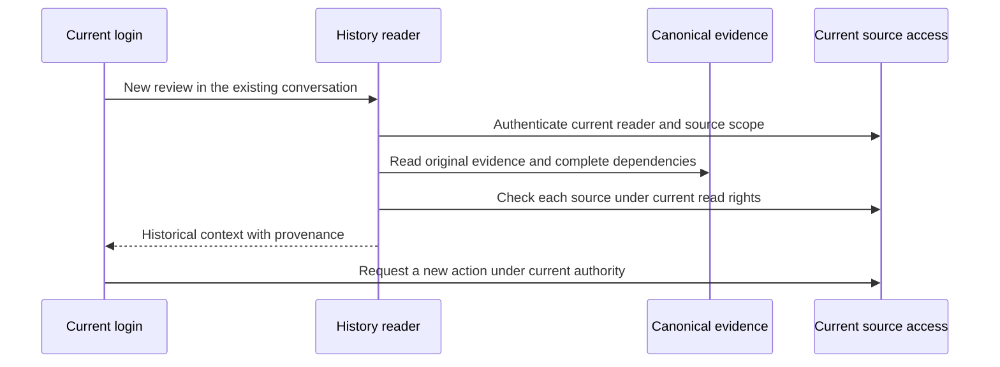

# Durable review context under current read access

Adopt current-reader history for normal reviews before implementation. The maintainer has approved the product direction. Reader: an engineer new to the context boundary.

A follow-up review must retain relevant, currently readable evidence after login renewal. A new credential must not resume, confirm, steer or publish for an old execution. An explicit fresh review must exclude earlier private context. Revocation, foreign identities, changed directory bindings and unproved source bytes must remain fenced.

Normal MCP reviews will read their recorded conversation under the current reader's identity and permissions. Historical credentials and run receipts remain evidence about the original producer, not permissions for a new action. This costs fresh access checks and canonical source reads at the existing context gates. The old execution and confirmation paths keep exact credential and owner checks. Fresh context remains available through an explicit request control.

## Today at `e7bda4291c54f1b5f95eecb5e85af2e0de5595d5`

| Fact | Source |
| --- | --- |
| New eligible human MCP Review and Ship review requests select empty history without testing whether old history is usable. | `src/channels/browserHomeInstallation.ts::admitNative`, `src/core/dispatch/requestOnlyPr.ts` |
| Private history checks every retained source through its original identity and credential; an unavailable source can block the stream. | `src/channels/homeAccessEpoch.ts`, `src/core/organization/service.ts::filterSources` |
| Native SSO verifiers live in adapter memory and are keyed by exact credential. Restart does not restore an old credential verifier. | `src/channels/organizationNativeSources.ts::currentMcp` |
| Version-2 execution GitHub receipts bind the result bytes, input and producer admission. Context validation permits execution receipts only in their original live run. | `src/core/dispatch/contextAccess.ts`, `src/core/dispatch/executionGithubContext.ts` |
| The organization history reader propagates native-media dependencies but does not propagate every other saved dependency. | `src/channels/browserHomeInstallation.ts::historyContext` |

## The shape

Use the [durable conversation](https://developers.openai.com/api/docs/guides/conversation-state) shape: stable user and conversation identity, immutable evidence, and current authorization at each read. Unlike a plain transcript store, this system must also revalidate sources from which an answer was derived. Add a read-only current-reader path beside exact original execution authentication. Reuse existing receipt and dependency schemas when their provenance already supplies the required proof.

## Login renewal during a review follow-up

A human completes a review, then the adapter restarts and the human logs in again. The new request has a new credential and a new source key. The history reader proves the same issuer, tenant and subject through the current credential, checks current directory and organization policy, and verifies each retained source. A historical GitHub result must match its recorded call, result hash and original admission; the current reader must still pass the declared GitHub read family. The new model receives historical findings plus their dependencies. It still fetches the current PR and head before a new verdict. Replaying the old key, accepting its confirmation or resuming its execution still requires its unchanged original authority.

This trace proves read continuity without transferring execution custody.

## Difficulty map

1. Keep current read proof out of old action paths. See Read authorization and old executions.
2. Preserve complete dependencies through derived history. See Saved evidence and access loss.
3. Preserve old request-only receipts while changing new selection. See Fresh reviews and compatibility.

## Read authorization and old executions

The organization stream passes its authenticated reader to the source-read check. Only a directly authenticated human MCP reader with the same stable external identity can use the new credential to read that identity's historical MCP source. Verify the current reader first, then reconstruct the original source scope for a read-only policy check. Direct human MCP history selects the same external identity, channel and thread; browser and Slack projections keep their broader person stream. The epoch and stream reader share one source-scope predicate. Unknown scope metadata remains held, not silently skipped. Do not mutate the saved source reference or register the new credential as a verifier for the old one. Cross-source, delegated, service and view-as reads retain their existing proof paths.

Source ownership, directory membership and current repository/source access remain required. Source-policy observations use one stable read fingerprint on every surface, excluding credential epochs and per-request target selections. It binds the stable source authority and full current grants; each retained source still gets its repository check. Receiver and action checks retain exact credential fingerprints. A separate `mcp-thread-context-v1` epoch domain binds new normal MCP frames to their channel and thread; old broad frames cannot restore through it. The source-read check requires current `repo:use` on the original source repository even for retained user text and command replies. A directory or policy change during an awaited read invalidates the captured epoch. Invalid or unavailable proof stops the dependent read; it does not authorize fresh execution from old state.

Old receipt replay, execution restoration, confirmation, steering and publication continue to use their exact original authentication. `evaluateSourceIdentity(identity, reference, onBehalfOf, reader)` is the read-only entry point. Its result is only `allowed` with a policy fingerprint, `denied`, or `unavailable`. Organization stream filtering and access-epoch checks pass the authenticated `reader`; action consumers do not. Native attachments keep their existing source-specific revalidation. MCP does not admit native media in this path; a fresh MCP login cannot supply proof for a linked Slack or browser source. `resolveEnvelope`, `authorizeExecution`, `authorizeReply` and `originalBinding` remain exact-original paths. Check the current reader and captured epoch again after history and dependency reads, before returning seed turns. The routing model hook must recheck the current canonical receiver and every inherited envelope, including versions 1 and 2. Typed context refusals propagate without a provider retry. The routing tail carries the seed envelopes into the operator decision. A runless organization routing decision uses the admitted request run ID as its canonical producer, with the existing organization-ingress correlation. The history reader can find that exact record without a text search or a second mapping. Missing legacy links remain unavailable. Question publication and storage revalidate that same complete envelope. The later model and publication guards revalidate the merged envelope.

## Saved evidence and access loss

Reuse historical GitHub receipts only after validating the canonical producer record, recorded input, result bytes and recorded admission hash. The producer must be finished, non-provisional and non-interrupted, with a finite recorded session range; a new run cannot adopt a foreign live execution. Run-read and destination checks apply before exposing its evidence. Require the current actor to hold `repo:use` for every receipt repository, then recheck the declared source read family with the current capability. The App installation alone is not reader authorization. Historical-only context uses the message-bound read validator for every consuming agent, including General and Coding. Only references whose producer run ID is the current run require its specialist execution admission. A mixed envelope checks each family through its own path. Original same-run execution checks retain their generation, admission and owner fences.

The private history reader admits a saved answer, including a command reply, only with its complete canonical `ContextDependencies` envelope in `known` state. It adds the canonical answer producer as a `ContextOrigin` and merges that envelope into the new seed, including origins, Slack receipts, MCP reads, GitHub repository leaves, execution GitHub receipts, memory scopes, unit statuses and native media. Missing or unknown producer metadata stops the dependent history read. Existing commands explicitly retain unknown output sources, so their replies remain unavailable for normal history reuse until a producer records complete source proof. A source-free assumption cannot replace that proof. One denied leaf blocks the dependent answer or summary; the reader does not strip that leaf and keep derived prose.

For an archived GitHub result, the finished non-provisional record must contain the exact execution reference in its canonical envelope. Read its bounded recorded session and find the version-2 controller receipt with the same producer run, call, result hash and admission hash. `recordedGithubRead` proves the original declared tool, input hash and returned bytes. `currentGithubReadCapability` checks the current declared tool family and its source API, rather than relying on repository enumeration. The private projection normalizes verified checkpoint aliases before merging source envelopes, so ordinary covered origins do not accumulate as separate dependencies. The original admission hash is provenance checked against the saved receipt and envelope; the archive does not retain every field needed to recompute the live admission hash. Add execution GitHub producer runs to the existing retention reference index. Holder retirement and explicit deletion retain their existing behavior. No new dependency schema or transcript store is required. The committed producer context and controller-annotated session are the two trusted storage records; neither can be supplied by a new request. Source reads return at most 100 eligible organization entries per execution tail. Scoped MCP tails scan up to 32 pages of 200 broad entries and refuse incomplete coverage instead of returning an unproved empty history. Successful organization stream results include `scopeExcluded` when the scope check removes entries; the count covers all scanned pages and contains no source identity. The admission trace also records `epochScopeExcluded` for the complete successful epoch scan, without source identity. The retained context has 32 ordinary dependency leaves per envelope, and 256 execution GitHub references. The source catalogue remains paged at 200 entries. Existing merge/overflow rules reject an envelope beyond its bounds; this change does not raise them. Native attachments retain their immutable source digest, stream binding and existing exact source proof. No old command, pending tool call, execution lease or confirmation is replayed from the transcript.

Context dependencies remain cumulative through summaries, notes, later model calls and publication. A source that becomes denied or unavailable blocks further use of dependent context. The user receives the existing specific refusal; a normal review must not silently become an independent review.

## Fresh reviews and compatibility

New normal review requests retain history. A control in the current authored prefix, `review-context:fresh`, explicitly selects the existing request-only path for Review or Ship review with one complete PR target. It is not sticky and cannot come from quoted text, saved context or a client-supplied internal marker. The existing target and ownership gates still apply.

Previously stored request-only receipts retain their mode and exact digest. Legacy same-thread answers remain readable with all their original dependencies, including dependencies from other conversations; this change scopes direct selection and does not rewrite old answer contents. The source-read fingerprint upgrade can fence older captures on their first new observation; it does not renew those executions. This change does not reinterpret an old receipt, release a held owner, migrate an unknown execution, or deploy anything. The existing notice remains correct for an explicit fresh review. A new conversation with no earlier history is normal and needs no warning.

## Alternatives

**Why not treat the new login as the old credential?** That would restore an old execution's capability, including confirmations and reply addresses. Current read proof is intentionally separate.

**Why not remove the banner?** The banner describes actual exclusion. Removing it would hide lost continuity.

**Why not keep automatic empty history?** It removes useful prior decisions even when their sources are readable. A standalone review remains an explicit supported choice.

**Why not add a second transcript store?** The existing organization stream, run ledger and session receipts already retain identity and provenance. A second store would duplicate state and revocation checks.

## Proof and rollout

Use the existing native MCP fixture to complete a review, restart the adapter, renew the login, and complete a follow-up whose provider input includes prior evidence and current GitHub data. Prove denied access, foreign identities, directory changes, altered receipts and old-key replay remain refused. Prove explicit fresh Review and Ship review omit prior context while normal requests retain it. Update the affected rows in `mcp-ingress.md`, `github-tools.md`, `organization-orchestration.md` and `session-log.md`. Run named affected test files and scoped type, spec and hygiene checks. CI, native review, deployment and live acceptance remain separate stages.

Added read latency and production frequency of unusable historical sources are unknown. Record added source-read count and latency in the existing trace; this local change has no production latency acceptance claim. The tests establish correctness with synthetic sources; production latency and real login-renewal acceptance require a separately authorized deployment trial.
