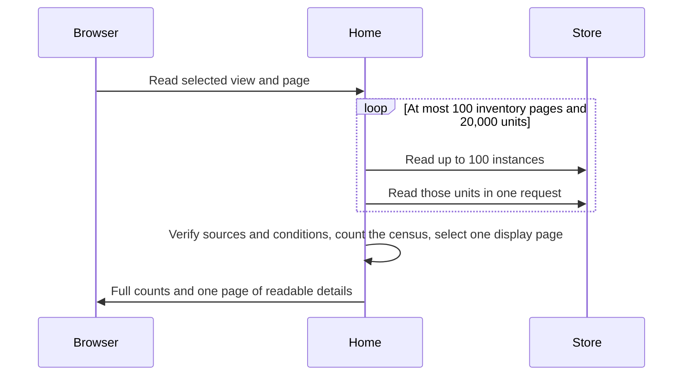

# Keep unfinished work visible in bounded Home views

Adopt state-based Home views for this dashboard repair. The assumed reader is an engineer new to Home. The decision is needed before implementation. The user has rejected an age cutoff for unfinished work.

The success criteria are: show standalone reviews; retain every unfinished unit; distinguish a saved wait from missing or failed evidence; bound page rendering; keep Messages usable after content removal; and contain composer growth.

## Proposal

Home must page unfinished work by its current evidence. It must never use age as proof of completion. The service keeps its complete bounded census and existing authorization checks. The browser receives one page of details and full category counts, with explicit partial-read notices. A batched unit read removes the separate remote request for every pipeline.

## Today at `e7bda4291`

| Fact | Owning source |
| --- | --- |
| Home movement requires a pipeline unit and its current child. Standalone reviews cannot qualify. | `src/core/home/live.ts`, `src/core/home/service.ts` |
| Home reads each pipeline's units through a separate storage call, with bounded concurrency. | `src/core/home/service.ts`, `src/core/coordinator/instanceStore.ts` |
| Every unresolved unit outside personal attention and movement falls into waiting, including legacy rows with no condition. | `src/core/home/service.ts` |
| Home renders a pipeline card for every unresolved pipeline. UnitList alone has a virtual window. | `web/green/pages/Home.vue`, `web/green/components/UnitList.vue` |
| Removing browser request content uses the organization deletion path, which invalidates readers. | `src/channels/homeRuntime.ts`, `src/core/organization/runtime.ts` |

One read of the live DOM found 1,011 pipeline cards, 36,717 elements, and 1,040 units under Other waits. These are one reader's visible projection, not a transactional storage count or a latency benchmark. The live Bot build was `991f65feed92fb013da7625e49379092e7fc0e8d`.

## Shape

This is a paged work queue. Unlike an inbox that expires old notifications, it keeps unfinished obligations until existing completion evidence retires them. Personal attention, pipeline movement, recorded waits, and unexplained or failed work remain separate. Standalone live runs use the existing permission-filtered run reader and keep their run links. The Home views neither restart nor settle work.

## Hard case

An old aborted unit has no current condition and no current live child. It remains unfinished under the existing completion rules. Home counts it under Needs investigation and provides its pipeline, original thread, and pull request links. A separate unit has a current checks condition and a next action. Home places that unit under Waiting. Neither disappears with age. A storage or condition failure leaves the coverage partial and cannot produce an all-clear state.

This trace preserves unfinished work without calling every unresolved record an active pipeline.

## Difficulty

Counts require the whole returned census before display pagination. The existing service stops at 100 inventory pages or 20,000 units and marks incomplete reads partial. This change does not make that scan constant cost. On a 1,011-pipeline fixture with one unit per pipeline, the inventory and unit call target is 22 calls instead of 1,022. Live-run and private-source proof calls are additional. The local response target is under one second for the synthetic fixture with no simulated network delay. This target tests local processing only. The local proof measures call counts and browser size; production latency remains unknown. A permission-safe durable index is a later option if the batched scan still misses the measured load target.

1. Classification must retain unknowns and distinguish valid saved waits from failed operations. A condition is evidence of a saved reason, not proof that the external worker still exists.
2. Batch reads must preserve canonical unit validation and per-reader private checks. A missing or invalid group fails coverage; it cannot become a confirmed empty pipeline.
3. Message removal closes its old stream before DELETE, obtains a fresh session, then refreshes the current page seed after a successful receipt. A changed access revision invalidates pending page reads. The router repeats the selected destination read before it can install. Message-history navigation stays blocked throughout deletion recovery. The fresh session must keep the same actor, organization, persisted conversation stream ID and binding revision. Closing the server-sent-events connection does not change that persisted stream ID. Deletion blocks new submissions and closes the old connection before sending DELETE. Navigation can change the page during deletion; it cannot reconnect the old stream or cancel recovery for the same actor. An unknown deletion response causes a current read, never a repeated DELETE. The fresh page still checks current permissions. The App hides the old page until that new seed arrives. Old frames cannot restore erased content or old work permissions.

## Decisions

Waiting requires at least one open condition, every condition owner to be person, automation or external, no failure condition, and a next action selected by the current condition producer. The condition reader validates the saved unit progress against current canonical unit facts. An unknown owner, a failure condition or an absent next action goes to Needs investigation. Unknown conditions, operation failures and rows with no reason go to Needs investigation. These labels report available evidence. They do not assign a new owner or assert a root cause.

Each page contains at most 50 primary rows for the selected category. Pipeline cards retain at most three work shortcuts each. Category counts describe the complete returned census, or are explicitly partial when its existing bounds or reads fail. Pagination is a current read; concurrent changes can move rows between pages. It is not an audit snapshot. Assigned actions remain reachable without an age filter.

Active pipeline cards require current movement or a valid recorded wait, including a person-owned condition. Other unresolved pipelines remain reachable through investigation rows and their pipeline links. A saved child wait with missing live evidence remains a recorded wait; it is not relabeled Working.

Standalone runs count as Moving only with a valid current state bound, no stop and no recovery pause. Provider, deploy and repository waits go to Waiting. Missing, expired or contradictory states go to Needs investigation. Every permitted execution stays visible. A public moving run can replace its repeated pipeline-unit card, but cannot hide a second run. Private pipeline child IDs remain outside the Home snapshot.

Counts disclose work outside the displayed page. The final private-source proof must therefore include every unit used in those counts, before any category count or page is emitted.

The storage batch accepts at most 100 instance IDs, 20,000 unit rows and 8 MiB of stored unit JSON and uses the same store key and credential boundary as existing unit reads. The reader filters instances before the batch and retains its private proof checks. An older Worker uses the existing individual read path until the Worker is updated. No background cache can carry rows across permission changes.

The composer uses bounded automatic growth, internal scrolling for long text, an explicit private destination label and an optional repository control. Repository discovery failure stays visible with a retry and does not disable ordinary questions. No new repository or private-read grant is introduced.

## Alternatives

**Why not reset or hide older records?** A reset discards evidence and the backlog returns. Age cannot prove that work shipped or that a required action ended.

**Why not maintain an index now?** That requires durable write coverage for every old and new unit transition. The existing census is already authoritative. Batching preserves that coverage with a smaller change; the request-count proof exposes the remaining linear cost.

**Why not virtualize every card?** That reduces DOM work but retains one remote request per pipeline and repeats work links. Batching and server pagination reduce both costs.

**Why not mark all terminal run records complete?** A finished execution can leave a deliverable, a question or an unknown external operation unresolved. Existing completion rules remain authoritative.

## Boundaries and validation

The reset owner retains the reset script. The renderer owner retains Slack emoji and backticks. Stop success requires the existing confirmed shutdown result; a warning cannot become a green success receipt.

Local regressions must prove complete paginated discovery, age-independent classification, missing-group refusal, standalone run visibility and permission filtering, and deletion recovery with late-frame refusal. The existing browser preview must show the new views and the composer at wide and narrow sizes. Compare batch request counts and rendered element counts on the same synthetic backlog. Live latency after release remains unproved until the new build is deployed under separate authority.
