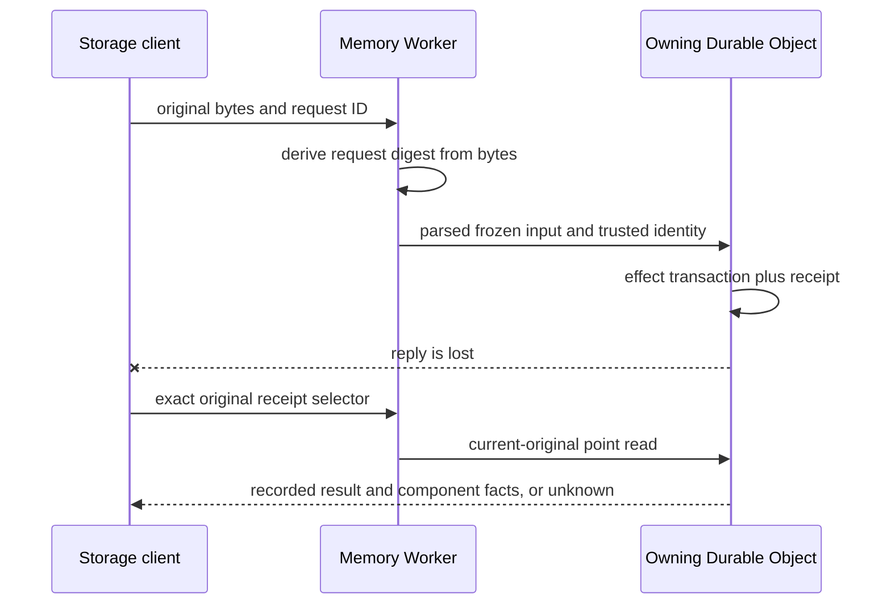

# Record original storage writes with their effects

Adopt transaction-bound receipts for the two original storage writes before implementation. The reader is an engineer who knows the run ledger. The source writer owns this decision within the authorized feature; the release owner retains deployment and live controls.

A lost HTTP reply leaves two storage outcomes unknown: `/runs/live-state` and `/runs/session/write`. Each owning Durable Object will save a small receipt in the same SQLite transaction as its effects. This adds one insert and bounded pruning per eligible write, plus a request hash at ingress and an effect hash before the transaction. Operators can then read a saved result for one exact request. Missing proof stays unknown and never permits replay.

## Today at `4502433af64cb65803b859ab7e63182c4dd59762`

| Fact | Source |
| --- | --- |
| The client freezes raw payload bytes and hashes `{operation,payload}` before dispatch. | `src/core/storeResponse.ts::storeRequestWitness` |
| The digest header is format-checked log correlation, not body proof. | `src/core/storageFailureDiagnostic.ts`, `src/core/storageTransport.ts` |
| RunHistory owns live-state effects in one synchronous transaction. Its input includes state patch and source events. | `deploy/cloudflare-memory/worker.ts::RunHistoryDO.assignLiveState` |
| SessionLog owns rows, attachments, sources and owner metadata in one synchronous transaction. A refused result can follow metadata writes. | `deploy/cloudflare-memory/worker.ts::SessionLogDO.write` |
| Original evidence reads bind current generation and metadata. Promoted runs additionally compare frozen admission metadata; ordinary runs lack that comparison. Neither binds a failed request. | `src/core/runLedger/originalEvidenceReader.ts`, `deploy/cloudflare-memory/worker.ts::RunHistoryDO.readOriginal` |

## The shape

Use the transactional outbox pattern within each owning object, but store a point-readable receipt instead of a message to deliver. The Worker derives the request digest from the frozen HTTP bytes using the existing witness algorithm. It passes this verified identity separately from diagnostic correlation. The owning object freezes its effect input, hashes the canonical operation/run/generation/input, then rechecks current owner, generation and applicable promotion/source fences in the transaction after every added wait. It saves the receipt inside the existing effect transaction. Receipts never store request bytes, rows, attachments, keys, exception prose or source payloads.

For example, request `11111111-1111-4111-8111-111111111111` writes row0 and source metadata for run `receipt-run`, generation `g1`. SQLite saves the effects and receipt together. The client loses the reply. An authorized `runs receipt receipt-run --gen g1 --operation conversation-write --request-id ... --digest ...` returns that recorded transaction result. A different digest, missing entry or changed owner returns unknown. No path repeats the write.

## Difficulty map

1. Bind the receipt to the actual effects, including a refused session write after metadata changes.
2. Keep the point read bound to the original owner and current reader authority across a SessionLog read.
3. Bound receipt storage and preserve deletion/reset privacy.

## Effects and result are separate facts

The primary key is request ID within each owning object. A receipt records version1, run ID, generation, operation, request ID, ingress digest, effect digest, private reader binding, a typed result summary and component facts. The result summary contains only `ok`, a closed refusal reason, and bounded numbers/booleans such as live-state sequence, bytes and source-save status. Live-state detail and event payloads do not enter it.

Live-state components count written events and state writes and identify whether context pinning ran, including an empty reference set. Session components count written rows and attachments and identify source metadata, source-owner metadata, source taint and whether byte-policy processing ran. These facts describe the original transaction, not the current contents after later writes. A refused result can have nonzero component facts. Neither `ok:false` nor zero row writes means no effects.

The object checks for a retained request ID inside the effect transaction before any mutation. A repeated request ID is refused with the existing fenced result, whether its digest matches or conflicts. The original receipt remains unchanged. This feature does not make these operations automatically retryable. A stale owner remains fenced by the existing owner checks. Legacy requests without a valid request ID retain existing behavior and produce no receipt. Session writes without an explicit canonical store/run/session binding also remain unsupported; the first-party client adds its existing store key to row writes. Direct internal RPCs without a trusted ingress identity also produce no receipt.

One enclosing synchronous transaction invokes the existing effect callback, then inserts the receipt before commit. Early returns leave the enclosing transaction active. A transaction-local collector starts with zero counts and false flags. Each SQL mutation updates its component fact immediately after success; the receipt takes both the callback result and this collector. A receipt insert failure throws and rolls back all effects. An exception before commit leaves no committed receipt. Validation and promotion holds outside the transaction produce no receipt. The trusted effect digest covers the actual parsed input, including live-state state patch/source events or session rows/attachments/sources/seed and owner identity. It is not a hash of the current whole run state.

## Original selection and reader authority

The new read takes run ID, generation, operation, request ID and ingress digest. Each receipt also retains a private reader binding: requester, channel, visibility, repository and thread at the original write. Live-state captures it from the canonical row inside its effect transaction. For eligible session writes, ingress obtains it from the canonical RunHistory owner with `{runId,gen,sessionKey}` before the write. This is a diagnostic snapshot, not a new write permit. SessionLog freezes it with the effect input. Inside the effect transaction, SessionLog compares its own stored owner run ID and generation with that exact request and checks revocation. A changed local owner refuses all effects and a success receipt. A concurrent RunHistory-only owner change cannot be made atomic across objects: the later point read rechecks RunHistory and returns unknown rather than using the old binding. SessionLog retains the snapshot only with the effects it actually owns. RunHistory uses the existing original evidence read, including promotion identity checks where available, then compares the current identity to the receipt binding. Ordinary runs without promotion proof rely on the identity frozen in their receipt, never on current metadata alone. For session writes it selects only the canonical run's current session key. It checks the original again after the SessionLog read and discards changed evidence. The command authorizes `runs:read` once against the returned canonical ordinary-run resource. Private worker runs remain hidden. A strict client codec rejects foreign selectors and extra fields.

The receipt result is either `recorded` with exact identity and typed facts, or `unknown` with a closed reason. Missing, evicted, predeployment, unsupported, corrupt, oversize and changed-owner proof stay unknown. A recorded transaction does not prove client acknowledgement, process ending, publication or permission to replay, settle or replace its owner. The in-memory ledger has no Memory HTTP ingress and reports unsupported rather than fabricating a receipt.

## Retention and privacy

Keep at most256 receipts per owning object, each at most4096 UTF-8 bytes. Prune oldest insertion sequence entries in the same transaction as insertion. This is a capacity contract: proof survives restart and remains until256 newer eligible transactions in the same object replace it. The maximum receipt JSON storage is 1 MiB per object, plus indexes. No minimum time window is promised. The write rate is unknown; the release owner can measure it before choosing any later time guarantee. A busy object can evict proof early; absence stays unknown. Use an indexed run ID for deletion. Canonical run deletion removes RunHistory receipts; SessionLog run revocation removes that run's receipts. Full installation reset destroys the owning object data, so receipts are not retained settings. No timer or new cleanup service is needed. At one eligible write per second,256 entries retain roughly4 minutes; at one per10seconds, roughly42minutes. These are workload scenarios, not measured serving rates. Retention across a busy shared RunHistory is a utility limit; no useful historical recovery window is claimed without a serving-rate measurement.

## Why not the smaller alternatives?

**Why not just add logs?** Logs are outside the effect transaction. Their absence cannot prove rollback, and a logged return cannot prove client receipt.

**Why not trust the existing digest header?** It has only a format check. The Worker must derive the digest from actual bytes before treating it as request evidence.

**Why not retry after a timeout?** A missing receipt can mean eviction, an old deployment, an incomplete call or unavailable evidence. It cannot prove the original made no effects.

**Why not put the result on the run ledger?** Session rows and attachments live in another object, so the run ledger cannot atomically attest their effects. A dedicated bounded table also preserves exact original request identity when later writes change the live state.

**Why not save a receipt after returning from the object?** A restart can separate that save from the original transaction. Only the owning transaction can bind both.

## Rollout and proof

The additive schema works with existing data. Older clients with valid request IDs gain receipts; legacy clients continue without proof. Source verification will use real SQLite and public HTTP for commit with discarded reply, precommit failure, duplicates/conflicts, mixed/source-only/refused-after-effects writes, owner/read fences, eviction, deletion and failed trace sinks. Strict codecs and command access get focused root tests. Current-head CI and one native review follow local checks. Merge, deployment and live acceptance remain separate gates; historical writes cannot gain retrospective receipts.

Living specs to update: original-run evidence, run history and session log. Exact tests replace these proof gaps in the implementation PR. This record remains proposed until source verification and review agree with the contract.
