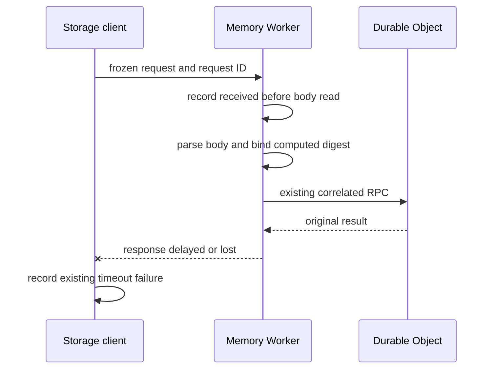

# Observe storage receipt and client acceptance without changing writes

This record describes the source implementation. The source writer adopted the design within the authorized telemetry change. The reader is an engineer new to this storage path; the release owner retains deployment and live acceptance. Native tracing remains disabled pending the separate provider checks below.

The required outcome is to distinguish observed waiting, execution and return boundaries for `/runs/state` and `/runs/heartbeat`. The design must preserve request identity, results and retry rules. It must state where provider queueing or reply loss remains unknown.

Add three bounded application records: HTTP receipt, decoded request identity and client envelope acceptance. This adds at most three application log records per eligible request. Use native client and server RPC spans after the provider privacy and volume checks pass. The records give positive evidence of progress without another storage write or acknowledgment protocol. The diagnostic contract does not depend on native trace retention: provider spans add context but cannot turn absent evidence into a result. Missing evidence still means unknown. This decision authorizes source implementation; it does not approve deployment or a trace-volume budget.

## Today at `c2c7a30bf3f6a97fa778ac1fab33e0bbc60503f0`

| Fact | Source |
| --- | --- |
| The client freezes the exact payload and hashes operation plus bytes before transport. It attempts to create a unique request ID; UUID generation failure leaves it absent. | `src/core/storeResponse.ts::storeRequestWitness`; `src/core/storageTransport.ts` |
| Failed requests already retain transport/body/acknowledgment phase, elapsed time and deadline state. Successful state and heartbeat responses have no client acceptance record. | `src/core/runLedgerWorker.ts::post`, `reportFailure`, `fenceResult` |
| Memory creates `state.fetch` at handler entry, but its log sink emits only on span end. Existing `storage.rpc.progress` records show each RPC attempt; they are not an early HTTP receipt. | `deploy/cloudflare-memory/worker.ts::fetch`; `src/core/trace/workerTrace.ts::workerLogSink`; `src/core/trace/sinks.ts::createLogSink` |
| The Memory template enables logs without native traces. The bot template enables native traces. | `deploy/cloudflare-memory/wrangler.template.jsonc`; `deploy/cloudflare/wrangler.template.jsonc` |
| The existing acceptance contract recognizes HTTP 200 with `ok:true`, or HTTP 409 with a known fence refusal. Heartbeat also applies compatibility casts and defaults. | `src/core/runLedgerWorker.ts::fenceResult`, `heartbeat`, `setState` |

## The shape

Use the OpenTelemetry client/server model: each side reports its own observation, and correlation joins them. Cloudflare supplies automatic RPC session, method and callee spans. Application records add the two facts that transport spans cannot supply: exact decoded request identity and application-level envelope acceptance. Reuse structured storage logging; add no telemetry SDK, database, recovery authority or new network request.

For fixture request `11111111-1111-4111-8111-111111111111`, Memory records receipt before awaiting its body. Only after parsing does it join the exact computed digest and validated target. If the Durable Object returns but the client times out, retained records show a server result without observed client acceptance before the deadline. They do not prove a lost reply. If the client instead decodes HTTP 200 with `ok:true`, it records accepted after the existing validator returns, then returns the same result. This proves envelope acceptance by that invocation, not process survival or later application adoption.

## Difficulty map

1. [Truthful boundaries](#truthful-boundaries): do not turn missing records, early headers or transport success into stronger facts.
2. [Result and privacy preservation](#result-and-privacy-preservation): failed logging must not alter the original call, request or retry behavior.
3. [Provider coverage](#provider-coverage): native spans have platform timing, retention and volume limits.

## Truthful boundaries

The hardest part is preserving the meaning of each observation under a partial failure. More transport spans cannot solve that problem. Memory emits a received event only for an authenticated POST to one of the two named routes. It includes the closed operation and a format-checked request ID. It has no run, generation or digest before parsing. The header digest is not trusted body evidence.

After the existing request witness is computed, Memory emits decoded identity before RPC dispatch. Reuse that witness rather than hash the body again. The record includes only the operation, request ID, computed digest and valid run/generation from its frozen context. Invalid JSON or an unfinished body retains receipt without a decoded record. Valid JSON with invalid state or lease fields can still have a decoded record; decoded does not mean the operation was admitted. A missing or invalid caller request ID remains absent; an independently generated witness ID does not establish an ingress join.

The client emits one acknowledgment record only after the existing fence-result validator recognizes an accepted or refused envelope. Limit this record to state and heartbeat. A successful HTTP status with an unreadable body or invalid acknowledgment emits no acceptance. The record distinguishes accepted from refused; it does not strengthen heartbeat field validation.

A receiver result and no caller completion means only that completion was not observed. The result can be late, discarded after cancellation, interrupted, or missing from retained logs. Provider delivery or queue evidence is needed to claim queueing. The published RPC attributes expose linked calls and invocations but no direct pre-method queue receipt. This design therefore records facts instead of generating a waiting/working/lost-reply verdict from missing rows.

## Result and privacy preservation

Use the existing immutable request witness and structured logging boundary. Construct output from an explicit field list. The allowlist excludes bodies, response data, session keys, credentials and exception prose from the three new application records. Request IDs and digests belong in records, never metric labels. The shared storage diagnostic helper writes one synchronous `console.log` call, with no added await or network call. A failed primary write attempts at most one fixed-field `console.warn`; if it fails, the original result still returns or throws. Each progress record has a selected 1 KiB encoded bound; tests check maximum valid identity fields. Neither failure starts a read, retry or write.

Add no durable acknowledgment store. The requirement is diagnostic observation, not a replay decision. A positive acceptance record proves that the client validator reached that point. An absence of records proves nothing. Evidence that must survive process and log loss would need a separate durability contract, which is outside this change.

The three stages use one closed `storage.request.progress` event schema. `received` contains side `worker`, operation and an optional valid request ID. `decoded` adds only computed digest and valid target identity from the existing witness; it is emitted immediately after that witness is ready and before the first RPC. `acknowledgement` has side `client`, the same witness identity, HTTP 200 or 409, accepted or refused, and a known fence reason when refused. Only the existing acceptance branch emits that final stage. No event spreads the supplied request or response object.

The native SQL implementation records query text and a count of bindings, not bound values. Storage input values must remain bound parameters; dynamic query text is restricted to placeholders and code-controlled clauses/identifiers. Native spans have a different boundary. They can include raw URL paths, including unknown or unauthenticated requests, SQL query text, KV keys/list prefixes and other HTTP metadata. Query-string redaction does not remove these fields. Before enabling or exporting native traces live, the release owner must audit the whole Worker with private path/query/body/response sentinels and representative SQL and KV-key paths. If that audit finds private data, retain native tracing disabled until a supported exclusion or safe export path is verified. This condition does not block the three allowlisted application records.

## Provider coverage

Keep `observability.traces.enabled:false` in the Memory source template until the release owner completes the privacy and volume checks. A later source change can enable it; this PR cannot activate it through the normal release path. Set `observability.redact_query_string:true` because native HTTP metadata includes URLs. Leave generation to the existing renderer. Native tracing would cover the Worker and its Durable Object classes; the application records cover only the two named routes. An unspecified native sampling rate defaults to 1. Choose an approved rate with the later enablement change; a configured rate does not prove complete export or retention.

Cloudflare documents linked RPC call/invocation spans and SQL timing. It also documents that non-I/O work can report zero milliseconds. Do not rank synchronous validation work by a zero duration. No published queue receipt was found in the checked provider contract; account-specific availability remains a provider question.

The source implementation also closes the existing tracer warning fallback: if both a span sink and its warning reporter throw, the original traced success or error still reaches the caller. This is part of failure preservation, not a new trace framework.

The release owner must verify the deployed tracing flag, one retained same-request caller/callee join and one accepted client envelope, zero private fixture values across the Worker-wide path/query/body/response/SQL/KV audit, and no added HTTP/RPC calls. The source contract permits at most three additional application records per eligible request, at most one fallback warning per failed primary record, and no added storage writes.

Daily eligible-request count, native spans per request and acceptable trace-volume budget are unknown. The existing production evidence owner must measure these and obtain a deployment budget before enabling this setting live. That is an operational gate, not an open question about the observation semantics. Do not claim live acceptance from source tests or enable tracing through a separate control action in this task.

## Why not just enable tracing?

HTTP client spans can end after headers and before body consumption. Native RPC spans also cannot prove that our client accepted the application acknowledgment. Three bounded application records fill those gaps without duplicating transport instrumentation.

## Why not retry or persist every acknowledgment?

An uncertain mutation can already have committed. Diagnostic gaps do not grant replay authority. A new acknowledgment round trip adds another uncertain operation; an acknowledgment store adds a durability contract that the current outcome does not need. Keep the existing mutation and heartbeat retry rules.

## Validation and affected specs

Update `run-history.md` and `tracing.md` with proof rows for early receipt, exact decoded identity, accepted/refused client envelopes and sink failure. Add behavior tests at the Worker HTTP and `WorkerRunLedger` public methods. Prove delayed/malformed body handling, invalid or absent request IDs, accepted/refused/malformed/interrupted responses, request identity under caller mutation, telemetry sink failure and unchanged request counts. Test rendered Memory configuration through the existing template renderer, including the disabled native tracing flag. Native provider spans and live privacy remain release-owner procedures, not local passes.

## Sources

- [OpenTelemetry RPC spans](https://opentelemetry.io/docs/specs/semconv/rpc/rpc-spans/): independent client and server lifecycles.
- [OpenTelemetry HTTP spans](https://opentelemetry.io/docs/specs/semconv/http/http-spans/): transport span duration does not necessarily include the response body.
- [Cloudflare spans and attributes](https://developers.cloudflare.com/workers/observability/traces/spans-and-attributes/): automatic RPC linkage and storage instrumentation.
- [Cloudflare tracing configuration](https://developers.cloudflare.com/workers/observability/traces/): enablement and sampling defaults.
- [Cloudflare tracing limits](https://developers.cloudflare.com/workers/observability/traces/known-limitations/): timing limits for non-I/O work.
- [Cloudflare SQL tracing source](https://github.com/cloudflare/workerd/blob/main/src/workerd/api/sql.c%2B%2B): query text and binding count.
- [AWS retry guidance](https://aws.amazon.com/builders-library/timeouts-retries-and-backoff-with-jitter/): retries need bounds and safe operation semantics; this change adds none.
