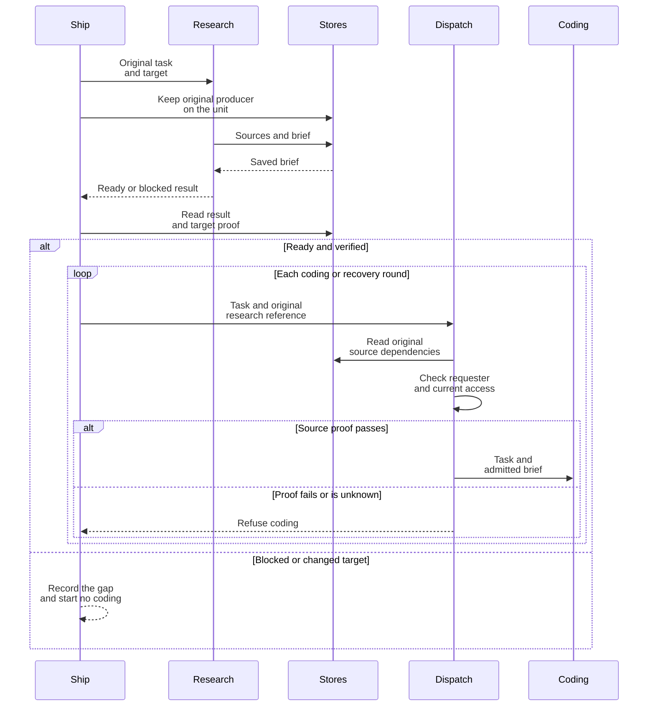
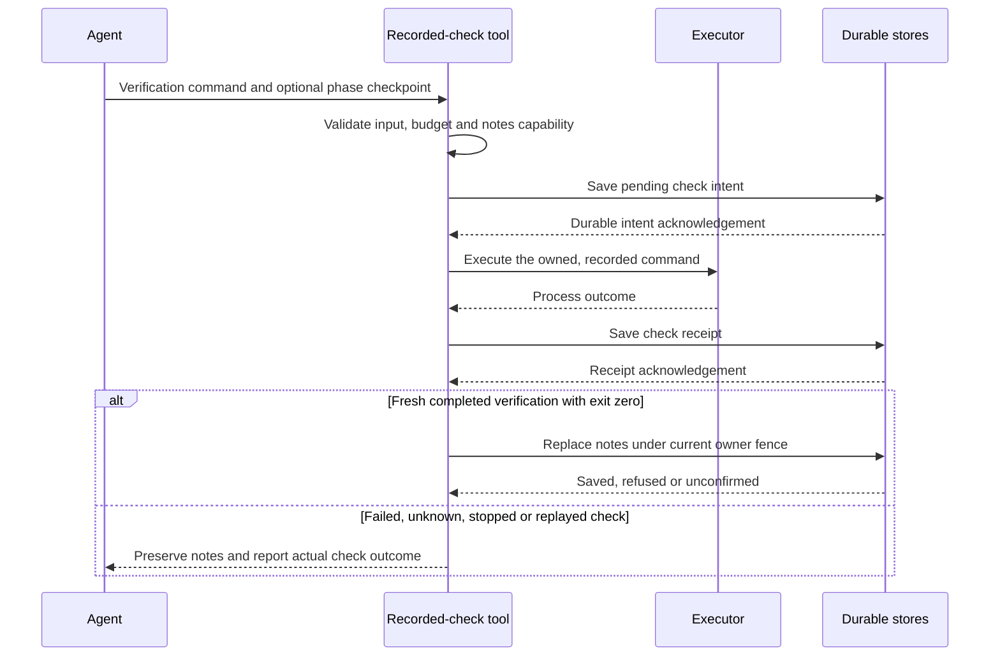
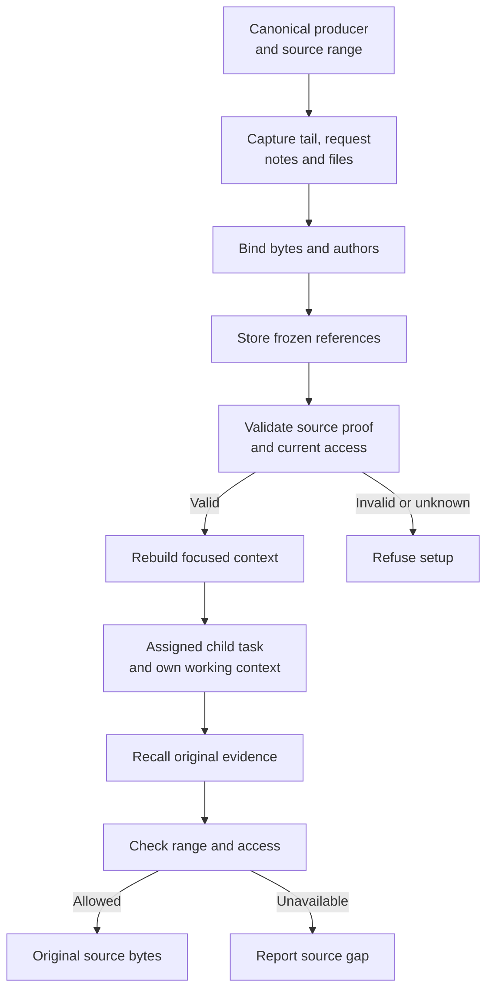

# Context lifecycle

This reference describes the records and checks that carry a task through research, implementation, verification, review and context recovery. [How agents keep context](../explanation/context-engineering.md) explains the same flow for users.

## Records and ownership

| Record | Owner and meaning |
|---|---|
| Admitted request and unit | The original requester, task, repository, branch and execution identity. Research does not replace these facts. |
| Research brief | A bounded advisory artifact: inspected revision, source claims, assumptions, unknowns, approach, verification and a ready or blocked decision. The store must acknowledge it. |
| Research run reference | The canonical first producer, retained on the unit after a proven spawn acknowledgement. Every implementation round and recovery must admit its original source dependencies under current requester and destination access. |
| Working notepad | One bounded document owned by the current writer. Checkpoint and ordinary notes writes use the same fence and preserve source dependencies. |
| Thread log | Original turns, tool exchanges and compaction entries. Runs occupy ranges of the log; retained rows can be recalled. |
| Child context | A frozen source range, request identity, working-note snapshot, artifacts and cumulative source dependencies. It grants no execution authority. |
| Recorded check | The actual process outcome, originating call, owner, purpose, command digest and observed checkout. A check result and a notes write have separate acknowledgements. |
| Scoped memory | Reusable distilled facts with original provenance. Memory is advisory and optional. |

## Research checks

The admitted workflow fixes its steps. Replay consumes the saved plan and step results under the original identity. An unknown start remains unresolved.

Review fixes, rebases, continued work and recovery retain the unit's original producer. Ordinary metadata writes preserve that reference; they cannot mint or replace it. The child tag and durable run metadata must match the canonical unit. A workflow that never admitted research keeps its recorded phase selection.

Maintenance conflict coding carries that same producer and its exact admitted target. The native spawn operation identifies the coding writer, including maintenance action keys. Review-only maintenance retains its existing phase selection. None of these paths creates a second research phase or resets the admitted budget.

Research spends the existing work budget. Its model and effort resolve through configuration. Coding setup checks the attached checkout against the inspected target; a continuation can use only the unit's recorded branch progress. A source claim inside the brief is not a verified read, and a ready decision is not authorization. Canonical producer identity, target binding and source-access checks supply those checks.

## Verification checkpoints

`run_check` accepts an optional `checkpoint` object with `phase`, `goal`, `decisions`, `rejected`, `completed`, `unproven` and `next`. Arrays may be empty. The rendered notes and receipt must fit the notepad budget.

The command starts only after durable acknowledgement of its pending intent. A failed or unconfirmed acknowledgement starts no command. The recorded checkout observation precedes command execution. Notes state that limit. They do not certify that the tree stayed unchanged or that a successful process exercised every claimed criterion.

An acknowledged notes write remains saved if a timeline observation fails. An unconfirmed notes write remains unconfirmed. Reusing a saved check receipt does not write another checkpoint or repeat execution.

## Focused child context and recall

Capture uses the bounded retained log tail and the canonical request row. The request's exact bytes and author are hash-bound when it falls outside the tail. The focused projection keeps the request, admitted user context, structured attachments, working notes and recall pointers; raw assistant and tool exploration remains in the frozen source log.

Projection does not clear original dependency obligations. A tool result cannot become a person's instruction because its transport role is `user`. Complete protected text is retained or refused when it exceeds the brief budget; attachments keep their existing limits.

Earlier context outside the selected window is named as omitted and remains recallable while retained and permitted. The projection does not claim to carry every historical correction. Parent notes stay frozen and read-only; child notes belong to the child's current writer.

## Outcome evaluation

`npm run load -- context --fixtures <recordings.jsonl>` scores independently labelled recordings. Explicit provider and model flags run local synthetic tasks through the provider, notes and recall interfaces. The command records metrics in unique JSON and Markdown files under the load-results directory.

Each trial binds task sources and notes, grading labels, target revision, execution limits, model, effort and environment. The evaluator checks known completion, boundary evidence, exact facts, required citations, retained notes and forbidden repeated commands. A partial trace, unknown output or incomplete child descriptor cannot pass.

Forbidden retries count from the first required compaction or resume through the rest of the trace. Later boundaries cannot erase a retry. Answer completion still requires an authored answer after the latest required boundary.

Provider failure and abort preserve a failed or interrupted trial with observed usage and stored notes. They do not trigger another run. Prices without recorded evidence remain unknown. Raw and managed arms use the same task data and limits; only their context projection differs.

These are local task measurements. Full provider acceptance, deployed source compatibility and production restart proof require their own evidence.

Behavioral contracts: [Research phase](specs/research-phase.md), [Recorded coding checks](specs/coding-checks.md), [Thread history contracts](specs/README.md), [Context evaluation](specs/context-evaluation.md), and [Ship](specs/agent-ship.md).
