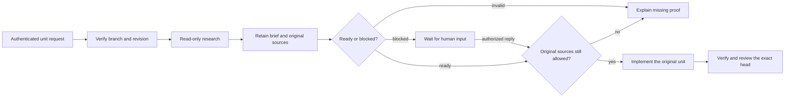

# Research phase

A bounded, read-only investigation prepares a task before implementation. Its brief preserves source claims, uncertainty, approach and planned proof. The original authenticated request and unit contract keep authority.

- **Code**: `src/core/research/brief.ts`, `src/core/research/source.ts`, `src/tools/research.ts`, `src/core/ship/coordinator.ts`, `src/core/coordinator/briefs.ts`, `src/core/coordinator/driver.ts`, `src/core/coordinator/contract.ts`, `src/core/coordinator/maintenanceChild.ts`, `src/core/coordinator/unitEffect.ts`, `src/core/coordinator/handOff.ts`, `src/core/coordinator/unitEffect.ts`, `src/core/coordinator/unitSeedReceipt.ts`, `src/core/coordinator/mainActions.ts`, `src/core/dispatch/unitSeedProof.ts`, `src/channels/adminCoordinator.ts`, `src/core/dispatcher.ts`, `src/core/dispatch/runLoop.ts`, `src/core/dispatch/reattach.ts`, `src/core/runsService.ts`, `src/core/pipelineStanding.ts`, `deploy/cloudflare-memory/worker.ts`
- **Tests**: `src/core/coordinator/briefs.test.ts`, `src/core/research/brief.test.ts`, `src/tools/research.test.ts`, `src/core/coordinator/driver.test.ts`, `src/core/coordinator/unitEffect.test.ts`, `src/core/coordinator/maintenanceChild.test.ts`, `src/core/coordinator/maintenanceSweep.test.ts`, `src/core/ship/coordinator.test.ts`, `src/core/coordinator/unitEffect.test.ts`, `src/core/coordinator/mainActions.test.ts`, `src/core/dispatch/unitSeedProof.test.ts`, `src/channels/adminCoordinator.test.ts`, `src/core/dispatcher.test.ts`, `src/core/dispatch/reattach.test.ts`, `src/core/runsService.test.ts`, `src/core/pipelineStanding.test.ts`, `deploy/cloudflare-memory/runLedger.test.ts`

## Behavior

1. **A bounded brief.** A versioned brief holds the goal, inspected full commit ID, complexity, readiness decision, source references, assumptions, unknowns, approach and verification. It is at most 8 KiB. A ready brief requires source evidence, an approach and verification. A blocked brief requires a concrete reason. Unknown fields and malformed or oversized briefs are refused.
2. **Context, not authority.** The rendered brief labels source claims as unverified and preserves uncertainty and planned proof. It does not replace the original task or authorize source changes.
3. **A visible question.** A completed blocked brief parks the original Ship unit for human input, even with idle disabled and no renewals. It retains the original research source and its blocked label. The next authorized human reply becomes attributed context for coding to recheck the prerequisite; it is not proof of readiness. No reply expires the wait; stop ends it. The quiet thread report is one line; verbose reports add the reply action. Failed or malformed research still aborts before implementation.
4. **An acknowledged artifact.** `submit_research` redacts and validates the brief, then waits for its run recorder to acknowledge durable storage. A missing recorder or failed acknowledgment returns an error. It does not acknowledge an incomplete brief or unavailable storage as saved.
5. **A real research step.** Ship runs the read-only, no-workspace research preset before the first implementation child when research is in the admitted workflow. The phase scopes simple work briefly and checks supplied plans against the current target. Research consumes the original unit lease and holds the implementation rounds' minimum budgets. It adds no write credential, model override or merge permission. Replays follow the admitted workflow's recorded phase selection.
6. **The original target and sources govern consumption.** The controller records the research repository and full revision in the child tag. A ready artifact, or a blocked artifact with its original unit’s durable human answer, must belong to the original instance, unit, actor and research step, and match that revision and the current implementation target. The attached implementation checkout must match the controller-bound head before a model turn. A continuation may retain the original source only through its own recorded branch progress. The dispatcher rechecks the original run's complete known dependency closure before model exposure and retains all source origins for later checks. Revoked, unknown or unavailable sources stop implementation.
7. **Uncertainty cannot restore earlier readiness.** Every later valid submission clears export eligibility before its write. The recorder retains its pending decision before attempting the state write and marks it confirmed only after acknowledgment. Unconfirmed retention cannot export the earlier ready brief. A resumed run may reconcile the latest submission against canonical stored state; a different state, missing latest intent or incomplete event history is insufficient, even when an event claims confirmation. Research submissions are not blindly replayed after restart.
8. **Model context is fenced data.** The dispatcher uses the shared untrusted-content fence around the research artifact. Embedded delimiters are broken. The original unit contract and authenticated request remain outside that fence. Human rendering keeps the research text readable.
9. **Body access and durable storage keep their boundaries.** Generic run metadata and lists omit research text. Explicit body reads use the existing private-worker gates. The original unit contract and a canonical source-bound seed must be acknowledged before the researcher model starts. The brief, original source closure and required source marker survive reclaim and final storage. A missing or changed source tag prevents resumed implementation.
10. **Research is reviewable work in progress.** The research request asks for a concise final answer with the decision, findings, source references, approach, verification and uncertainty. It uses the existing requester chat and permitted body-read seams. A completed research round keeps the unit open in the research stage. Coding starts a separate coding stage; research completion never marks a unit merged or done.
11. **Research recovery keeps the original lease.** Research has no workspace repository field. Recovery verifies its complete canonical source record and controller-bound repository, unit and branch, then charges its actual recorded spend alongside coding and review. Missing or foreign source tags, incomplete history and unknown prices grant no recovery credit. The original deadline and cost cap remain in force.

12. **Every implementation retains the same original research.** The accepted native research spawn records one immutable producer ID on the original unit. Accepted source-bound coding records a writer pointer; the pointer alone proves no push. Contract retries, findings, rebases, renewals and recovery inherit that original source. Metadata updates preserve both pointers and cannot create or replace them. Every coding dispatch checks the canonical unit, source marker, current requester and original known dependency closure before model exposure; unknown unit storage or missing or conflicting markers refuses. Native push receipts may prove an advanced head; a complete canonical writer tied to its accepted source-bound admission may retain that same admitted head after failure without a new push. Bare publication metadata, foreign steps and unknown publication outcomes grant no head credit. A retained native rebase receipt must match the original unit and target. Legacy units and existing-PR review-only workflows without an admitted producer keep their recorded phase selection and acquire no research requirement.
13. **Maintenance keeps the same research boundary.** A bounded maintenance coding conflict repair carries the unit’s original producer and the exact verified native target under the original requester, destination, maintenance action, lease and paid-round allowance. The dispatcher checks current source access before model exposure. Native completion or reconciliation recognizes the explicit maintenance coding operation and retains its writer pointer with the paid-round receipt. Later continuation accepts that writer only through its exact unit/maintenance/action key and the matching canonical action/run receipt, with the ordinary native head and source checks. Unknown acknowledgment grants no writer or spend credit. Legacy and standalone maintenance and clean-rebase delta reviews acquire no research producer or coding-only gate.

## Acceptance

| Criterion | Proof |
| --- | --- |
| 1: ready requires complete, bounded source evidence, approach and verification | `[unit]` `src/core/research/brief.test.ts::research brief::refuses readiness without evidence, source references, an approach or verification`, `::refuses an oversized or malformed brief while preserving a bounded simple brief` |
| 2: advisory rendering carries sources, uncertainty and observable verification | `[unit]` `src/core/research/brief.test.ts::research brief::accepts a ready brief and renders evidence, uncertainty and planned proof as advisory context` |
| 3: a blocked brief names its missing decision | `[unit]` `src/core/research/brief.test.ts::research brief::accepts a blocked brief and shows its required missing decision` |
| 3: blocked research waits without renewals; the reply continues the same unit with its original source and spend | `[unit]` `src/core/coordinator/driver.test.ts::Ship research phase::the research answer resumes the original unit without another producer or renewal and keeps its cost cap: %s`, `src/core/coordinator/briefs.test.ts::composeChild — the child a brief names::a research answer briefs coding as attributed input without replacing the unit or its controls` |
| 3: durable question and wake preserve the remaining lease, ignore older input and replay the same answer | `[unit]` `src/channels/adminCoordinator.test.ts::the plan runner's steps — plan, unit-start, branch, round, unit-end, finish (item 9)::a research question persists and the next reply resumes its original lease with no renewal` |
| 6: blocked source consumption requires its own canonical answer; a foreign or unrelated answer cannot restore eligibility | `[unit]` `src/channels/adminCoordinator.test.ts::research source at implementation admission::a blocked original research source requires its own durable answer: %s`, `src/core/dispatcher.test.ts::dispatch::admits research with its original source closure and refuses revoked or unknown research before the provider` |
| 4: valid artifacts wait for storage and expose blocked decisions; invalid input and missing storage refuse | `[unit]` `src/tools/research.test.ts::submit_research::records a valid brief after durable acknowledgment and reports a blocked decision`, `::refuses an incomplete brief and missing or failed durable storage` |
| 5: research precedes coding and review within the original lease; a blocked result starts no coding child | `[unit]` `src/core/coordinator/driver.test.ts::Ship research phase::runs bounded research before coding and carries its original run into the coding contract`, `::parks blocked research for input before starting an implementation child` |
| 6: original unit, actor and target are bound; missing source or changed target refuses before dispatch | `[unit]` `src/channels/adminCoordinator.test.ts::research source at implementation admission::carries only the canonical original research run into implementation`, `::refuses a changed target or foreign research actor before dispatch`, `::dispatches research on the original target and refuses a missing implementation source` |
| 6, 8: malicious goal, evidence and approach stay in one effective fence; known original obligations are retained; revoked or unknown source refuses before the provider | `[unit]` `src/core/dispatcher.test.ts::dispatch::admits research with its original source closure and refuses revoked or unknown research before the provider` |
| 7: a later unconfirmed or throwing blocked write cannot export earlier ready research or be admitted as ready | `[unit]` `src/core/dispatcher.test.ts::run ledger write-through (docs/reference/specs/run-history.md item 35)::withholds earlier ready research…` |
| 7, 9: resumed finish preserves the exact artifact and older source origins, reconciles canonical latest state, and withholds stale readiness without another model call | `[unit]` `src/core/dispatcher.test.ts::run ledger write-through (docs/reference/specs/run-history.md item 35)::restores research eligibility…` |
| 9: a missing or changed required research tag cannot silently disappear on reattach | `[unit]` `src/core/dispatch/reattach.test.ts::carriedCoordinatorTag: the tag a resumed run carries forward::retains the required original research source and refuses a missing or changed tag` |
| 9: metadata omits research text; explicit private bodies require the existing private access gate | `[unit]` `src/core/runsService.test.ts::RunsService.getRun::keeps research text out of metadata and applies private body gates to explicit research reads` |
| 9: research seed acknowledgment binds its admitted role, original contract, requester, private unit and exact step; a missing phase selection, changed step or changed contract refuses | `[unit]` `src/core/dispatch/unitSeedProof.test.ts::canonical unit seed acknowledgment::acknowledges the admitted research seed with its original contract and role`, `::refuses an invalid research seed (%s)` |
| 9: a no-workspace researcher settles its own exact spawn only with admitted phase and canonical target evidence; missing, foreign or changed target and conflicting metadata refuse | `[unit]` `src/core/coordinator/unitEffect.test.ts::spawn effect durable receipt::accepts a workspace-less research spawn only from its admitted immutable target tag`, `::refuses research spawn evidence with %s` |
| 9: actual SQLite retains brief, source closure and coding source tag across reclaim and final storage | `[unit]` `deploy/cloudflare-memory/runLedger.test.ts::research artifacts in real SQLite::retains the exact research brief and source closure across reclaim and final storage` |
| 10: research completion keeps the unit open; coding and the actual unit ending settle its stage | `[unit]` `src/core/pipelineStanding.test.ts::the fold binds rounds by adjacency, ignores a companion's state and is total over the unions::keeps completed research open until coding and a unit ending settle the work` |

| 6: a moved attached checkout refuses before implementation while the same inspected head starts | `[unit]` `src/core/dispatcher.test.ts::dispatch::admits research with its original source closure and refuses revoked or unknown research before the provider` |
| 11: workspace-less research, coding and review retain priced spend, the original deadline and cost cap; invalid sources or prices refuse without a claim | `[unit]` `src/channels/adminCoordinator.test.ts::POST /admin/coordinator/recover-unit — unchanged-head original-unit recovery::historical admission::research history in original recovery::carries workspace-less research and coding spend into the original recovered lease`, `::refuses…before claiming the original recovered lease`, `::counts paid research against the original cost cap instead of renewing that cap` |

| 12: every writer brief retains the original producer and original writer; a restored adopted unit skips repeat research without changing spend | `[unit]` `src/core/ship/coordinator.test.ts::the unit pipeline — every ending the ship pipeline has, on step returns::retains original research and the recorded writer…`, `::a fresh adopted PR selects research only without its retained producer…` |
| 12: native admission preserves one original producer and a source-bound writer; ordinary updates cannot replace or drop them; foreign sources refuse | `[unit]` `src/core/coordinator/unitEffect.test.ts::spawn effect durable receipt::retains one immutable original research source through resolve and ordinary metadata updates`, `::refuses a second research producer instead of replacing the original source`, `::updates only the canonical source-bound writer pointer and refuses unadmitted source markers` |
| 12: later findings and rebases retain the original source; missing sources, foreign steps, publication-only head claims and unknown writers refuse; native progress and unchanged failed admissions remain usable | `[unit]` `src/channels/adminCoordinator.test.ts::research source at implementation admission::retains the canonical original source in a later…`, `::uses canonical research progression…` |
| 12: later coding revalidates original sources; unknown unit storage or missing or conflicting admission markers refuses before the provider; a known legacy unit remains usable | `[unit]` `src/core/dispatcher.test.ts::dispatch::admits research with its original source closure and refuses revoked or unknown research before the provider` |
| 12: actual SQLite preserves the original research and writer through accepted native spawn, settle, reread and metadata omission, and refuses replacement or dropped pointers | `[unit]` `deploy/cloudflare-memory/runLedger.test.ts::spawn effect durable receipt transaction::reads the exact research child and retained admission inside the unit transaction, preserving unknown work on absent or foreign evidence` |

| 13: maintenance coding retains the original producer, exact native target, original actor, lease and cost bound; delta review adds no coding-only source | `[unit]` `src/core/coordinator/maintenanceChild.test.ts::original maintenance child admission::retains original research and the exact native target for coding while delta review stays read-only` |
| 13: accepted completion and reconciliation retain the exact source-bound maintenance writer and paid-round receipt; wrong returned pointers refuse | `[unit]` `src/core/coordinator/unitEffect.test.ts::spawn effect durable receipt::retains a source-bound maintenance writer…` |
| 13: maintenance conflict admission charges once, retains unknown outcomes and avoids replay; legacy and native delta-review behavior stays intact | `[unit]` `src/core/coordinator/maintenanceSweep.test.ts::durable maintenance sweep integration::*` |
| 13: real command and watch maintenance coding enter the provider with original source closure; revoked sources and changed attached targets start no model | `[unit]` `src/core/dispatcher.test.ts::dispatch::admits research with its original source closure and refuses revoked or unknown research before the provider` |
| 13: later continuation accepts only the exact canonical maintenance action/run receipt and refuses another action or foreign namespace | `[unit]` `src/channels/adminCoordinator.test.ts::research source at implementation admission::uses canonical research progression…` |
